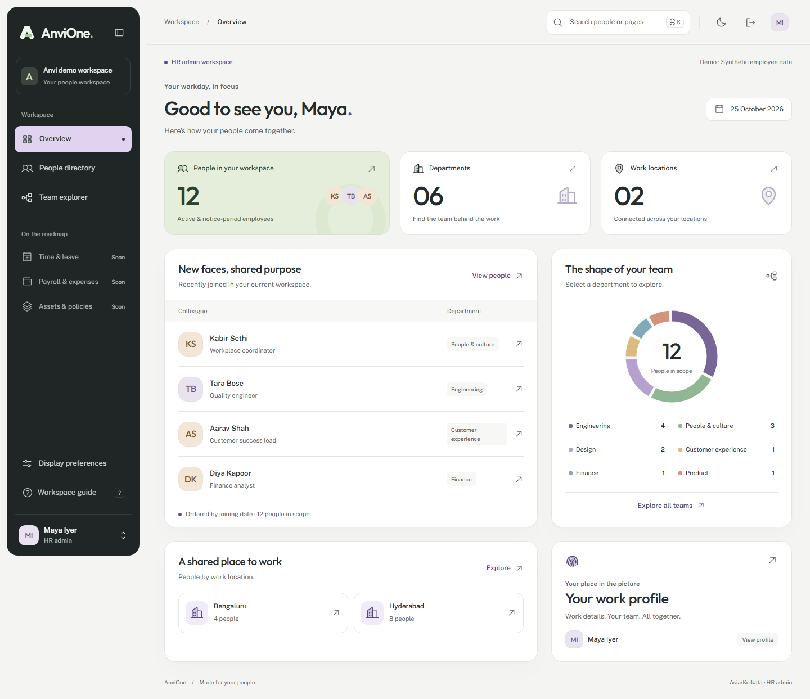

# AnviOne / MyAnvi

A people workspace for HR, managers and employees. **Foundation preview: synthetic data only.**

The foundation includes the **Anvi Atlas** visual system: a responsive people dashboard, scoped team explorer, directory cards/list, profile sections, searchable activity records, branding previews and personal display preferences. HR can now maintain departments and locations in **Organization**, with permanent codes, version checks and a recorded reason. People and employment records are separate, employee-code reservations are permanent, and approved identity binding has a restricted operations command. Role switching, PostgreSQL isolation and transactional audit/outbox remain enforced. Upcoming HR domains are visibly marked and are not operational yet.



The onboarding preview now includes an explicit starter checklist, custom tasks with coordinating owners, joining-relative due dates, prerequisites, status notes and required-task progress. Candidates see only their own tasks; HR coordinates internal owners. HR also sees field-by-field differences between resubmissions. Checklist completion and form approval do not activate employment. See [checklist evidence](docs/acceptance-evidence/onboarding-checklist.md).

Once the form and every required task are complete, HR can hand the synthetic case to a different HR identity through the independent-readiness decision lane. The proposer cannot approve their own request; decisions are versioned, audited and retained in immutable history. This local sign-off still creates no employee or access. See [maker-checker evidence](docs/acceptance-evidence/local-readiness-maker-checker.md).

HR can assign non-candidate checklist work to an active employee in the same legal entity. Employee and manager workspaces expose only their own minimal task docket—never the candidate form or contact details—and allow a versioned status update with a required note. See [assigned-task evidence](docs/acceptance-evidence/assigned-onboarding-task-workspace.md).

## Everyday HR modules

These modules run on the same tenant isolation, versioned edits and audit/outbox trail as the foundation. All data is synthetic.

| Module           | Who uses it                | What it does                                                                                                                      | Evidence                                                         |
| ---------------- | -------------------------- | --------------------------------------------------------------------------------------------------------------------------------- | ---------------------------------------------------------------- |
| **Leave**        | Employees, managers, HR    | Balances kept in a ledger, requests counted in business days, approve/decline/cancel with a reason                                | [leave](docs/acceptance-evidence/leave-ledger-workflow.md)       |
| **Attendance**   | Employees, managers, HR    | Check in/out, correction requests and reviews                                                                                     | [attendance](docs/acceptance-evidence/attendance-corrections.md) |
| **Holidays**     | HR (edit), everyone (view) | Working week and holiday calendar per legal entity, feeding leave day counts                                                      | [calendar](docs/acceptance-evidence/holiday-work-calendar.md)    |
| **Approvals**    | Managers, HR               | One inbox for leave, attendance corrections, readiness reviews and documents, with shared routing rules                           | [approvals](docs/acceptance-evidence/approval-workflow-core.md)  |
| **Documents**    | Employees, HR              | PDF/PNG/JPEG upload (5 MB, type checked from the file's bytes, PDFs with active content refused), verification, audited downloads | [documents](docs/acceptance-evidence/employee-documents.md)      |
| **Activity log** | Auditors                   | Searchable record of every action, filterable by module                                                                           | [Atlas](docs/acceptance-evidence/atlas.md)                       |

Interface text is centralized in `apps/portal/app/lib/copy.ts` and `apps/portal/app/lib/copy/` so a translation can replace one catalog without touching screens. The worker also purges expired and idle sessions every minute; refused sign-ins and rate-limited auth calls are logged as `auth.sign_in_failed` and `auth.rate_limited`. Set `TRUST_PROXY` to your reverse proxy's addresses (or a hop count of 1–5) when one is used.

## Run locally

Prerequisites: Git, Docker Engine/Desktop, and pnpm 11.21.0. Bootstrap Node 24.18+ is supported; `pnpm install` provisions the project-pinned **Node 24.22.1** runtime without changing the machine-wide installation.

```sh
pnpm install --frozen-lockfile
pnpm setup:local
pnpm db:up
pnpm db:migrate
pnpm db:seed
pnpm dev
```

Open **http://127.0.0.1:5173** and choose **Explore demo workspace**. Use `127.0.0.1`, not `localhost`, because the exact application origin is checked. The API binds to `127.0.0.1:4000`; PostgreSQL is exposed only on `127.0.0.1:55432`. Stop app processes with Ctrl+C; `docker compose stop` retains the local data volume. Do not tunnel or publicly expose demo mode.

`setup:local` generates random credentials in ignored `.env` and never replaces an existing file. The seed is development-only and idempotent. All names and `anvi.example` addresses are fictional. The profile button opens assigned roles: HR admin, Employee, Team manager, Platform admin and Auditor. Employee sees only self; manager sees direct reports; platform admin configures branding; auditor reads activity.

For synthetic onboarding, run `pnpm setup:local` and `pnpm db:migrate` after updating, then start `pnpm candidate:api` and `pnpm candidate:dev` in two additional terminals. Select **HR admin → Candidate intake** in the employee portal. Create an `@anvi.example` intake and invitation preview, then open the local delivery tray. The candidate opens **http://127.0.0.2:5174**, requests a code, and HR refreshes the tray to retrieve it. No email is sent. The separate hostname isolates candidate cookies; do not substitute the employee hostname. Candidate startup refuses production mode. Form approval does not activate employment. See [candidate design](docs/adr/0004-candidate-preview.md) and [requirements coverage](docs/requirements-traceability.md).

The internal outbox receipt worker can be run separately:

```sh
pnpm worker
```

It records internal event consumption. It does not send email or claim external delivery.

## Validate

```sh
pnpm format:check
pnpm check
pnpm audit --audit-level=moderate
pnpm test:integration
pnpm exec playwright install chromium
pnpm test:e2e
docker build -f infra/docker/Dockerfile.api -t anvione-api:foundation .
pnpm exec node scripts/smoke-image.mjs
```

Integration and browser tests use the synthetic local database. They exercise role grants, organization records and branding, and must never target a production database. Run the integration suite before the browser suite, not concurrently. Build before browser tests: CI starts the API and Vite's local preview of `build/client`; locally, Playwright can reuse an already-running development server. `pnpm --filter @anvi/portal preview` also serves the built portal on port 5173 while the API is running. Vite preview is for local review, not production hosting. See [foundation evidence](docs/acceptance-evidence/foundation.md), [Atlas evidence](docs/acceptance-evidence/atlas.md) and [people/organization evidence](docs/acceptance-evidence/people-organization.md) for measured results and limitations.

## Code map

| Location             | Responsibility                                                   |
| -------------------- | ---------------------------------------------------------------- |
| `apps/portal`        | React Router SPA, responsive screens and TanStack Query hooks    |
| `apps/api`           | NestJS HTTP boundaries, OIDC/session handling, platform services |
| `apps/worker`        | Outbox receipt consumer and stale-session cleanup                |
| `packages/contracts` | Shared Zod input/output contracts                                |
| `packages/authz`     | Role-to-permission and scope policy                              |
| `packages/database`  | SQL migrations, RLS transactions, audit/outbox, synthetic seed   |
| `packages/ui`        | React Aria controls and Anvi design tokens                       |
| `tests`              | Real PostgreSQL/API tests and browser journeys                   |

Read [the consolidated architecture decision](docs/adr/0001-consolidated-foundation.md), [Atlas design decision](docs/adr/0002-atlas-experience.md), [people and organization decision](docs/adr/0003-people-organization-identity.md), [delivery backlog](docs/backlog.md), [API contract](docs/api/openapi.json), [setup/identity runbook](docs/runbooks/development-and-identity.md), [controlled identity operations](docs/runbooks/identity-operations.md), [threat model](docs/threat-model/foundation.md) and [data-protection policy draft](docs/compliance/data-protection-policy.md).

## Release boundary

Corporate OIDC is implemented but has **not** been verified against the organization's Entra tenant. Leave, attendance, holidays, approvals and documents are implemented for synthetic data. Real identity provisioning, complete onboarding/activation, malware scanning and object storage for files, notifications, payroll, AI, MCP and TimeSphere remain future slices. Production requires the identity, privacy, security and operations gates in the backlog, including TLS/CSP, managed keys, independent audit storage, backup restore evidence and security review. Automated tests are not a compliance certification.

No paid UI assets, third-party profile photographs, remote fonts or tracking scripts are included. Third-party licenses and design inspiration are described in [THIRD_PARTY_NOTICES.md](THIRD_PARTY_NOTICES.md). Original planning prompts remain local; reviewed decisions and synthetic implementation are published.
