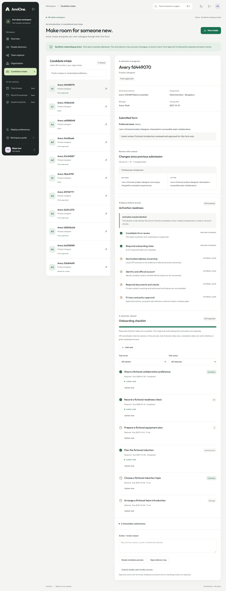

# F0.6 acceptance evidence: activation readiness dossier

Date: 25 October 2026. Scope: synthetic development preview only.

## Delivered

- Server-derived, non-editable readiness projection on the HR-scoped case detail.
- Six explicit controls: form review, required checklist, nominated-address ownership, identity/official account, documents/checks and privacy/policy approval.
- Local controls update from authoritative case/task records; optional tasks do not block them.
- External controls remain blocked and state why. `activationReady` cannot become true in this preview.
- Candidate sessions receive no readiness dossier and no new permissions.
- Responsive Atlas readiness rail with semantic status text, light/dark compatibility and reduced-motion handling.

## Verification

- Unit tests cover local projection, required versus optional tasks, strict control identifiers and deny-by-default external gates.
- Integration coverage proves the form/checklist state changes are reflected, external controls remain blocked and no employee record is created.
- Browser coverage locates the labelled readiness region, verifies four external gates and retains the existing onboarding accessibility/responsive journey.

This evidence is not production approval. Email delivery, identity/document evidence, approved privacy controls, transactional activation, SSO binding and employee-code issuance remain unavailable.
