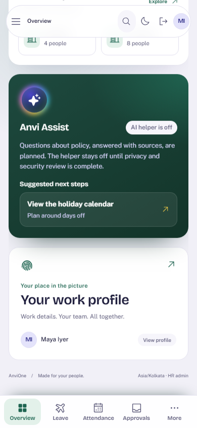
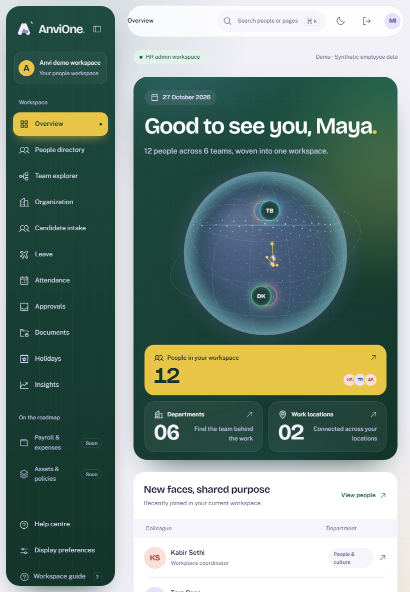
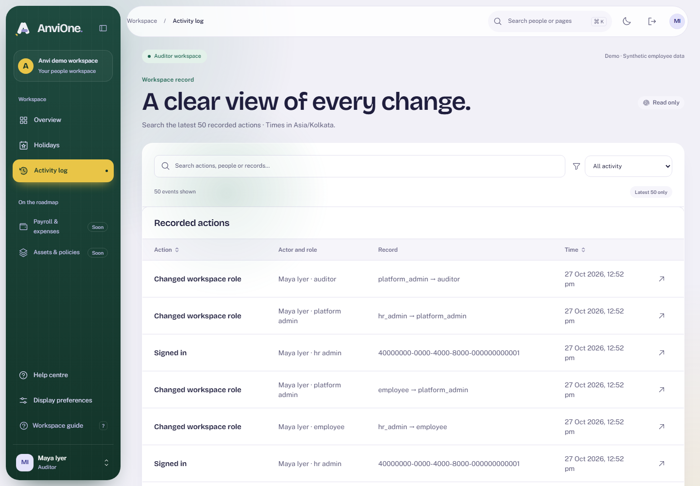
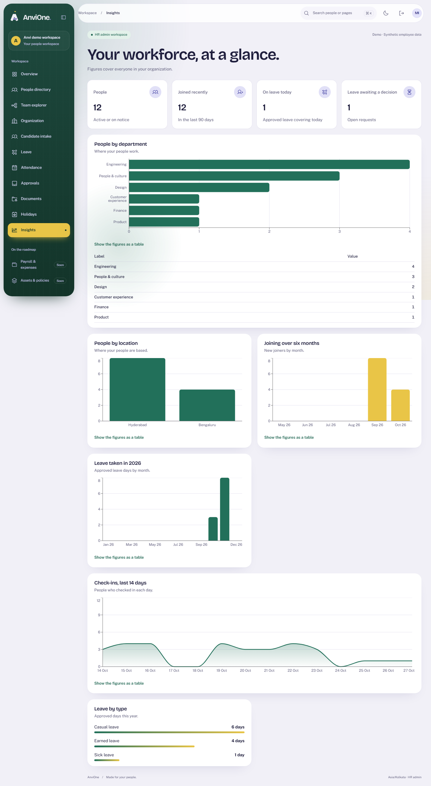
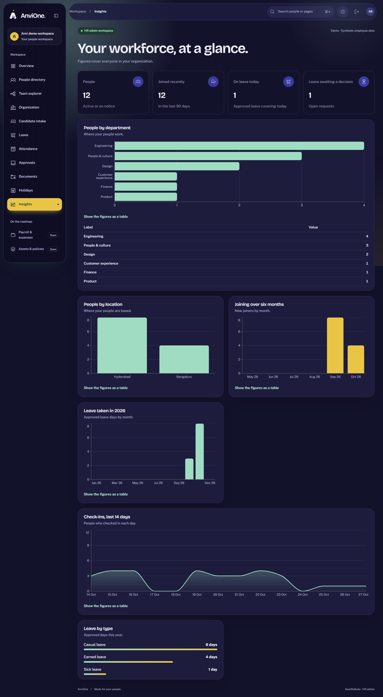
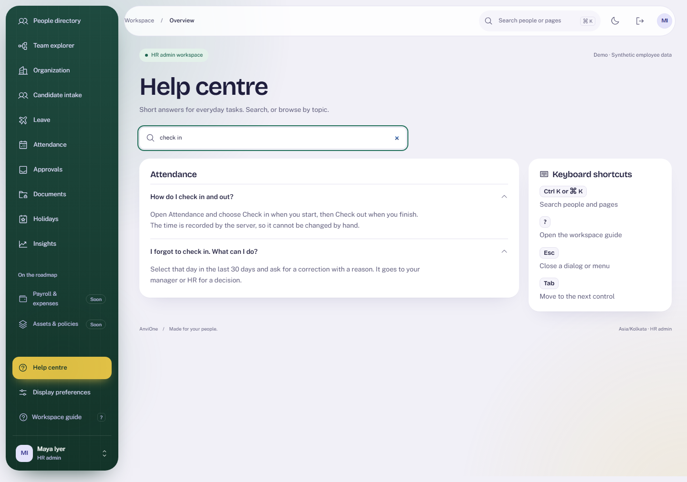

# Acceptance evidence: adaptive layout, component kit, Insights and Help

Decision: [ADR 0007](../adr/0007-adaptive-component-kit.md). Plan: [Insights and Help](../plans/insights-and-help.md). Synthetic data only.

## What was verified

| Claim                                                | Check                                                                                                                                                                                                        |
| ---------------------------------------------------- | ------------------------------------------------------------------------------------------------------------------------------------------------------------------------------------------------------------ |
| Every screen adapts from 360 to 1920 px              | `devices.spec.ts` loads 13 screens and resizes through six sizes; fails on sideways scroll, clipped content or touch targets under 24 px                                                                     |
| Phones get a bottom bar; tablets and desktops do not | Bar visible at 390 px with four links and More; hidden at 768, 1024 and 1440 px; page end is never covered; More opens the full menu                                                                         |
| Option cards are real controls                       | Theme, mode and density radios cover their whole card; the all-palettes accessibility journey passes in 3 palettes and both modes                                                                            |
| Insights is correctly scoped                         | Integration: anonymous 401; HR counts equal the directory and are internally consistent; manager total equals the team directory; employee, auditor and platform admin 403; no personal keys in the response |
| Insights is accessible and responsive                | Browser: five charts each with a table, axe WCAG 2.2 AA in light and dark, manager scope text, employee denial, one column and no sideways scroll at 390 px                                                  |
| Help search works                                    | Browser: filtering, live result count, empty result, clearing, axe                                                                                                                                           |
| Existing flows are intact after the page rebuilds    | All earlier browser journeys (leave, attendance, approvals, documents, holidays, onboarding, organization, activity, people) pass                                                                            |
| The globe no longer crashes under load               | Frame time is clamped at zero and the pulse index normalized; the earlier intermittent console error did not recur                                                                                           |

Final run: format, typecheck, lint and builds clean; 48 unit, 110 integration and 21 browser tests pass.

## Reviews

- Opus security review of the Insights endpoint: no critical, high or medium findings. Two low findings (consistent team boundary for leave counts; load on large tenants) were applied together with migration 021.
- Sonnet review of the UI diff before commit.

## Limits

- Real-device and screen-reader testing, and frame-rate measurement on low-end phones, remain open under UX-02.
- Insights shows counts for the caller's current scope only; there are no trends, exports or drill-downs.
- Untitled UI PRO components and templates are not used. Unused vendored free components can still be pruned to reduce CSS.
