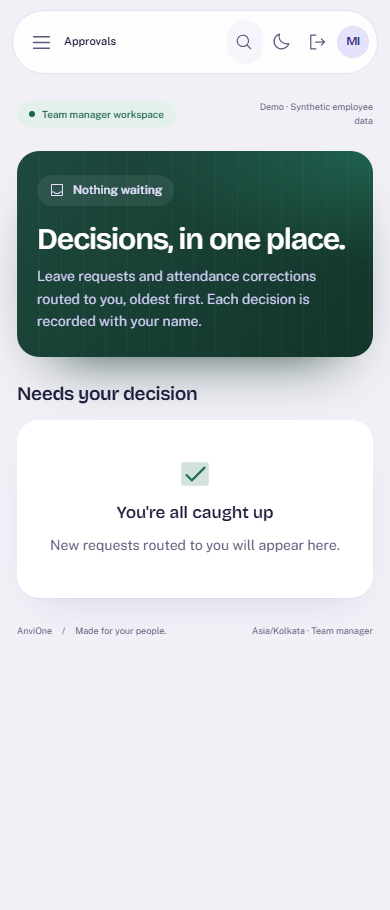

# Shared approval routing and inbox evidence

Validated 26 October 2026 against synthetic local data.

## Accepted behavior

- Leave requests and attendance corrections route and authorize decisions through two shared database functions. The current manager decides, or HR when there is none. Nobody decides their own request, and the decider must be a current employee. HR decides manager-routed work whose manager no longer manages the requester. The runtime role cannot call these functions directly.
- The existing leave (12 checks) and attendance (11 checks) suites pass unchanged against the shared rules. An independent review compared the replaced guards line by line and confirmed identical messages, error codes and check order.
- Managers and HR have one Approvals inbox, with a waiting count in the navigation. Items they can decide come first, oldest first; items routed to someone else are listed separately. Employees do not see the inbox, and the API refuses them.
- Approving or declining from the inbox uses each module's versioned endpoint, so audit, outbox, ledger and attendance effects are unchanged and stale versions still conflict.
- The screen passes the suite's WCAG 2 A/AA axe rules in light and dark mode and fits 390px.

## Honest boundary

No configurable multi-step workflows, delegation, escalation, reminders or SLAs. Onboarding readiness reviews are not yet in the inbox. Each module caps its pending list at 100 items.
