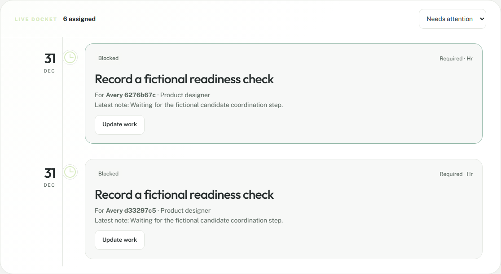

# Assigned onboarding task workspace evidence

Validated 25 October 2026 against synthetic local data.

## Accepted behavior

- HR can assign or reassign a non-candidate checklist task to an active employee in the candidate's legal entity. Assignment is versioned with the candidate case and commits with audit and outbox records.
- Employee and manager roles receive only their own assignment projection: task metadata, minimal candidate name/title and assignment context. Candidate email, draft, submissions and review details are absent.
- The assignee can update status with a mandatory note. Task dependencies, cancelled-case rules and optimistic concurrency remain server-enforced; a concurrent completion produces one success and one conflict.
- FORCE RLS denies other employees, candidate-task assignment and non-HR assignment writes. A security-definer predicate avoids recursive policy evaluation without granting direct candidate-case access.
- The Atlas work docket is keyboard operable, responsive without horizontal overflow at 320, 768 and 1440 pixels, reduced-motion aware, and passes the automated WCAG 2 A/AA axe rules used by the suite.
- HR sees the assignee and the completed state after the employee returns the task.

## Evidence commands

The focused browser journey passed with Chromium and exercised assignment, role switching, minimal disclosure, status completion, focus restoration, axe and viewport checks. The full release gate additionally runs format, lint, TypeScript, unit/build, dependency audit, serial PostgreSQL integration tests, the complete browser suite and container smoke.

## Honest boundary

This is a synthetic coordination preview. It does not send notifications, validate evidence, provision identity, activate employment, delegate tasks or provide reminders/escalation. Manual screen-reader, zoom, Safari and Firefox acceptance remain required before production.
