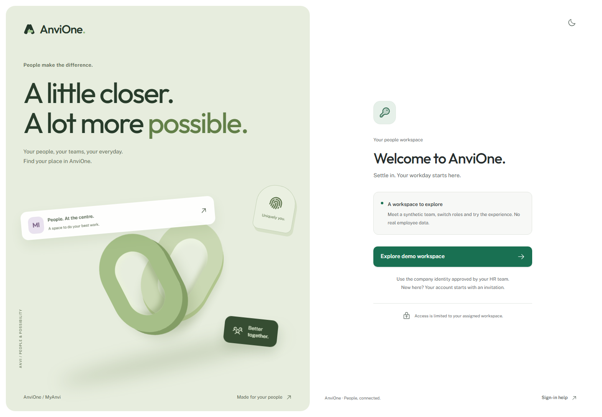

# Atlas experience acceptance evidence

Recorded 25 October 2026. Scope: F0.2 on the synthetic foundation preview. Windows/PowerShell, Node 24.22.1, pnpm 11.21.0, PostgreSQL 18.6 and Chromium. Design choices and reference limitations are in [ADR 0002](../adr/0002-atlas-experience.md).

## Delivered experience

The Atlas visual system covers login, overview, people directory, profiles, team explorer, display preferences, branding, activity and the existing error states. It adds self-hosted Outfit/Public Sans typography, Phosphor icons, a collapsible desktop sidebar, mobile navigation, original CSS ring artwork, selectable department composition, URL-persisted directory views, keyboard profile tabs, audit filters/details and personal display controls. Motion and the locally adapted MIT Magic Card provide restrained feedback.

All people counts and destinations use existing scoped APIs. No new employee data fields or wider permissions were introduced. Query cancellation now reaches fetch, and only public sign-in configuration is retained during demo login; private query data is removed. Local storage contains only appearance, density, motion and navigation preferences. No Dribbble artwork, external fonts, tracking scripts or employee photographs are included.

## Validation

| Check                                           | Result                                                                  |
| ----------------------------------------------- | ----------------------------------------------------------------------- |
| Format, lint, strict types and production build | Passed locally                                                          |
| Unit suite                                      | 11 passing tests                                                        |
| PostgreSQL/API integration                      | 15 passing results, including the parent test                           |
| Browser acceptance suite                        | Seven passing Chromium journeys in `tests/e2e` against the built portal |
| Dependency audit                                | `pnpm audit --audit-level=moderate`: no known vulnerabilities           |
| Peer dependencies                               | `pnpm peers check`: no issues                                           |

Browser journeys exercise department-to-directory navigation, persistent list view, profile keyboard tabs, department/location filters, compact density, saved motion preference, collapsed navigation, role reduction, unauthorized team access, branding publication/reload, desktop/mobile branding previews, audit filtering/empty states/details, command search and sign-out.

Responsive overflow checks cover 320, 360, 390, 768, 1280, 1920 and 2560px on overview, directory, teams, profile and preferences. Branding/activity cover 320, 360, 768, 1280 and 1920px. Login covers desktop and 360px; the missing-page view covers 320px. Screenshots were visually inspected, including mobile profiles and desktop branding.

Axe checks use WCAG 2 A/AA, 2.1 AA and 2.2 AA tags. Core screens are checked in all three palettes and both light/dark modes. Additional coverage includes login light/dark, mobile screens, collapsed navigation, the activity details dialog, branding, audit and the missing-page state. This is automated coverage of tested states, not a declaration of WCAG conformance.

Review corrected profile definition-list semantics, selected preference contrast and decorative login text contrast. The installed Motion hook snapshots its initial reduced-motion preference, so the application explicitly subscribes to media-query changes. Browser checks cover changing the OS preference in both directions without a reload and retaining the personal override. The server's authentication rate limit remains unchanged; redundant login configuration refetches were removed.

Browser checks use the built SPA through a loopback-only Vite preview and the real local API/database. Vite preview is not the production hosting strategy. The [foundation evidence](foundation.md) records the underlying authorization and database negative scenarios.

## Screenshots

Screenshots contain synthetic records. Iris was the persisted organization palette during capture; Atlas and Woodland are also supported.

Other views: [dark overview](atlas-dark.png), [mobile overview](atlas-mobile.png), [people directory](atlas-people.png), [mobile profile](atlas-profile-mobile.png), [team explorer](atlas-teams.png), [display preferences](atlas-preferences.png), [branding preview](atlas-branding.png), [activity](atlas-activity.png).

## Remaining gates

Manual screen-reader and zoom/reflow review, Safari/Firefox coverage, touch-device performance, full localization, all admin palette/state combinations, live Entra validation and production privacy/security/operations acceptance remain outstanding. Activation, onboarding, files, attendance, leave and payroll are still separate backlog slices. This increment is a reviewable foundation experience, not approval to process real employee data.
