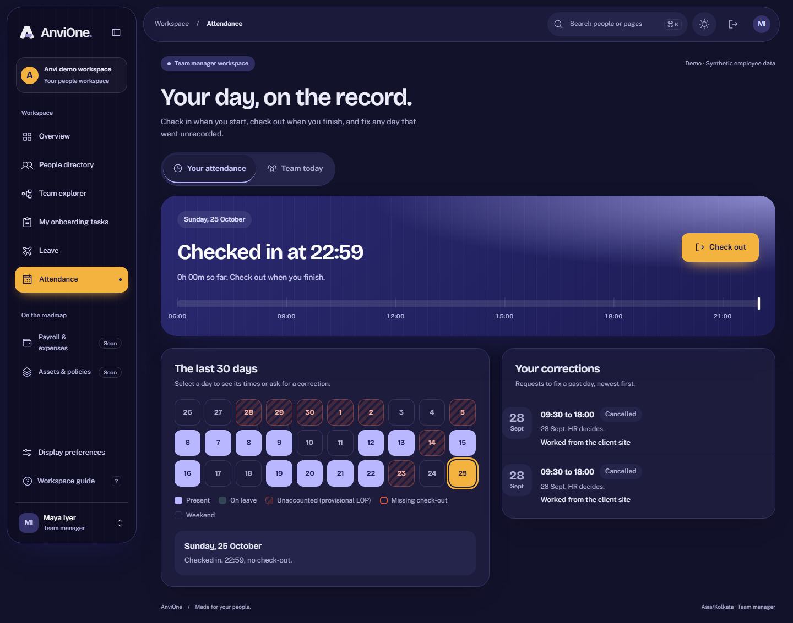

# Attendance and corrections evidence

Validated 25 October 2026 against synthetic local data.

## Accepted behavior

- Employees and managers check in and out for today only. Times come from the server clock in the legal entity's time zone; request bodies cannot carry times. A second check-in, a second check-out, a stale version and a same-minute check-out are rejected.
- The 30-day view derives each day as present, checked in, missing check-out, on leave (approved leave), weekend, not started or unaccounted. Unaccounted past working days are labelled provisional LOP for review only; nothing is deducted or sent to payroll.
- A correction covers one of the previous 30 days, needs ordered times and a reason, and allows one pending request per day. It routes to the requester's current manager, or HR when there is none. Nobody decides their own correction. A former manager cannot decide; HR can decide requests whose manager has moved on. Approval rewrites that day's record exactly once under concurrency.
- The correction path cannot be reused by the runtime role to write arbitrary times: column grants and an exact-match guard reject it. Records and corrections cannot be deleted.
- Managers see a live board of their direct reports; HR sees the entity. Punches, corrections and decisions commit audit and outbox records.
- The screen passes the suite's WCAG 2 A/AA axe rules in light and dark mode, fits 390px, and respects reduced motion for the live thread.

An independent security review found no exploitable issues. Its three minor fixes landed here and were also applied to leave through migration 016: HR fallback for stale managers, fail-closed time-zone lookup and accurate conflict messages.

## Evidence commands

`tests/attendance.integration.ts` (11 checks), the attendance cases in `packages/contracts/src/workforce.test.ts`, and `tests/e2e/attendance.spec.ts` passed with the full lint, typecheck, 34 unit, build, 74 integration and 11 browser checks. Seeded demo history is restored byte-for-byte after the integration run.

## Honest boundary

No shifts, holidays, overnight work, geofencing or devices, overtime, regularisation policy, notifications, export or payroll effect. Manual screen-reader, zoom, Safari and Firefox acceptance remain required before production.
