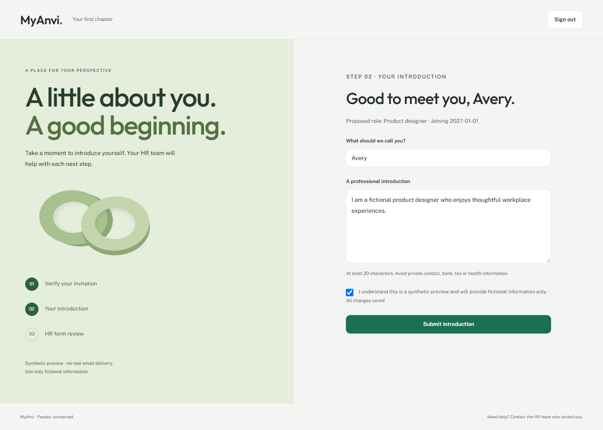
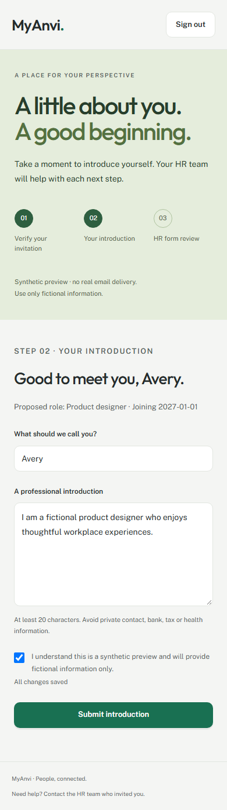
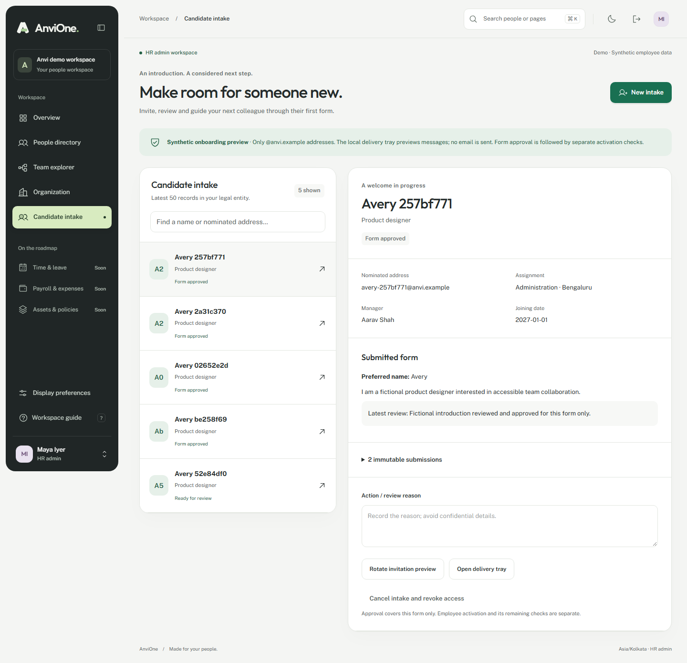

# F0.4 candidate onboarding preview

Date: 25 October 2026. Synthetic local development/demo only. This completes the bounded invitation-to-form-review preview, not full onboarding or employee activation.

Implemented: HR/entity-scoped intake with active assignments; 72-hour hashed invitations; encrypted and audited local delivery tray; challenge-bound keyed OTP hashes with expiry, persisted five-attempt lockout and cooldown/quota; single-use exchange; separate-host candidate cookies and restricted database role; optimistic autosave; immutable submissions; correction/resubmission and HR form approval; rotation/revocation; atomic submission/audit/outbox writes. Candidate production startup is rejected.

Validation:

- `pnpm check`: lint, TypeScript, 20 unit checks, API/worker bundles and both portal builds pass.
- `pnpm test:integration`: 42 results pass (38 scenarios and four parent tests), covering the existing foundation and candidate API/database boundaries. Candidate checks include expired challenges/invitations, wrong/replayed codes, cookie and CSRF separation, candidate source-table denial, stale saves, simultaneous submission, mandatory-audit rollback, immutable correction history and credential revocation.
- `pnpm test:e2e`: nine Chromium journeys pass. Candidate onboarding crosses employee/candidate hostnames and verifies reload-persistent autosave, correction/resubmission and form approval. Candidate widths 320/390/768/1440 and HR intake widths 320/768/1440 fit without horizontal overflow; axe checks cover candidate entry/form/completion and HR intake/dialog/review. Automated checks do not establish complete WCAG conformance.
- Dependency audit: no known vulnerabilities at moderate-or-higher threshold. Migration/seed rerun is idempotent.

Remaining gates: real nominated-email verification/delivery, approved retention and cleanup, full required form fields/tasks/documents/checks, shared maker-checker workflow, transactional activation, employee-code issuance at activation, policy/leave initialization, real welcome delivery, live Entra, managed keys/TLS, external immutable audit, manual accessibility/cross-browser/security/performance review. Preview acknowledgement is not legal consent. An approved form creates no employment or employee access.

See [design decision](../adr/0004-candidate-preview.md), [requirements coverage](../requirements-traceability.md), [backlog](../backlog.md) and [candidate API contract](../api/candidate-openapi.json).
