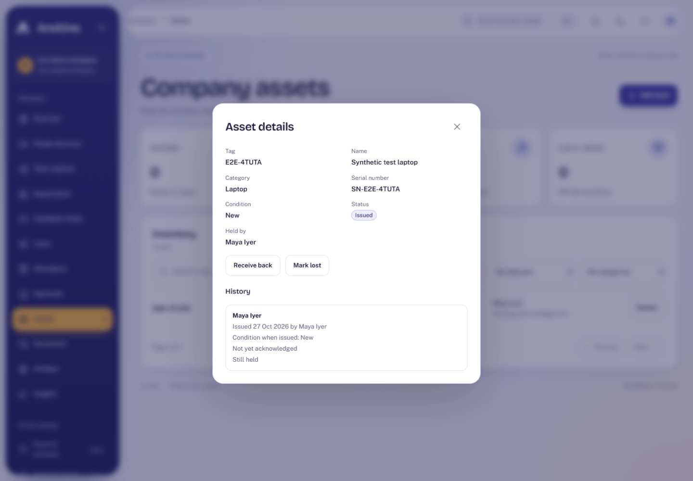
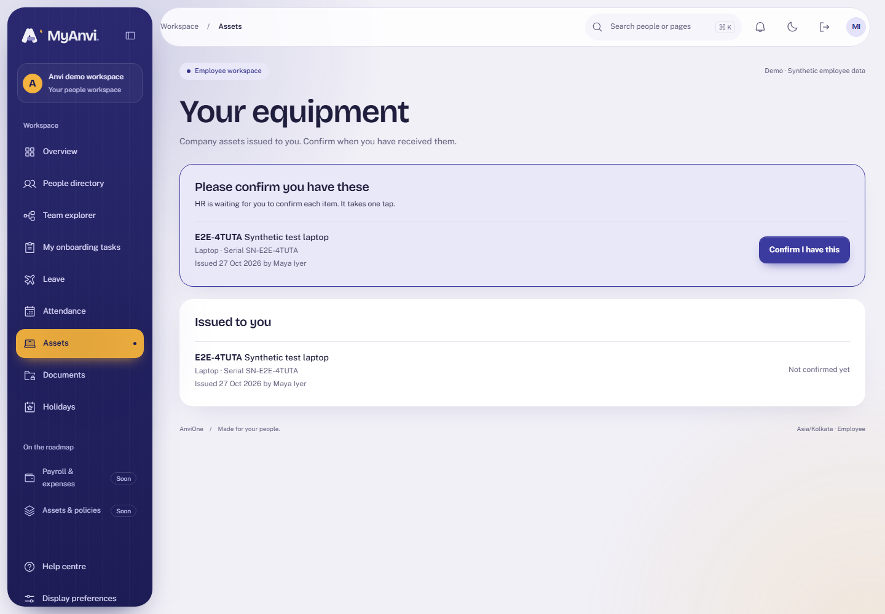
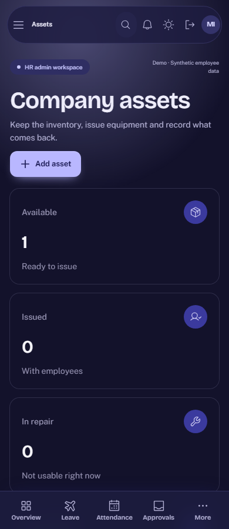

# Acceptance evidence: Company assets

Plan: [Company assets](../plans/company-assets.md). Synthetic data only.

## What was verified

| Claim                                                                       | Check                                                                                                                                                                                                                            |
| --------------------------------------------------------------------------- | -------------------------------------------------------------------------------------------------------------------------------------------------------------------------------------------------------------------------------- |
| HR registers and issues equipment; the holder confirms; HR receives it back | Browser journey across HR and Employee contexts, with the history shown to HR                                                                                                                                                    |
| Only HR manages the inventory                                               | Integration: employee, manager, auditor and platform admin get 403 on list and create                                                                                                                                            |
| People see only their own assignments and cannot confirm another's          | Integration: a colleague's assignment is absent from the holder's list and acknowledging it returns 404; HR cannot acknowledge on anyone's behalf                                                                                |
| The history is honest                                                       | Integration: issue, acknowledgement, damaged return with note, lost with reason, found, retire; past holders keep seeing what they held                                                                                          |
| Lifecycle rules hold                                                        | Integration: stale versions conflict; an issued asset cannot be repaired or retired until returned; retired is final and cannot be edited; issue dates cannot be future, before the asset existed or overlap the previous holder |
| The database holds the rules by itself                                      | Integration: employee writes affect no rows or fail; skipping the lifecycle fails; deletes fail; rewriting an assignment's facts fails; an asset without a matching open assignment cannot commit                                |
| Every change is recorded                                                    | Integration: audit records and outbox events exist for register, issue, acknowledge, return and status change                                                                                                                    |
| Accessible and responsive                                                   | Browser: axe WCAG 2.2 AA in light and dark on HR and holder screens; no sideways scroll at 390 px; the device audit includes `/assets`                                                                                           |

## Reviews

An Opus review of the migration, guards, store and contracts found no serious issues; its findings were applied, with one (HR acknowledging in the HR context) kept by design and documented.

## Limits

- No recovery on exit yet (EXT-01), no bulk import, no labels.
- A single-HR deployment can issue equipment to themselves.
- Frame rate, real-device and screen-reader checks remain open under UX-02.
