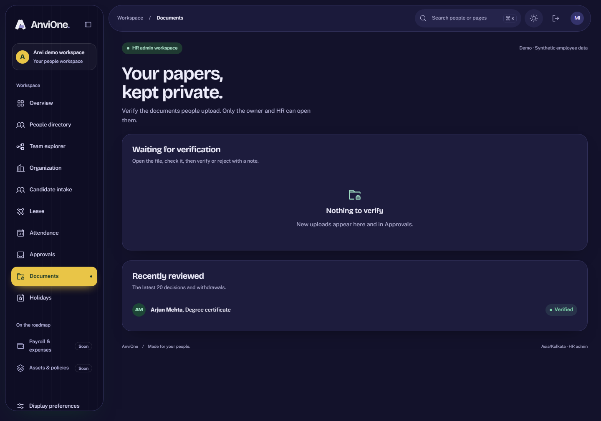

# Employee documents evidence

Validated 26 October 2026 against synthetic local data.

## Accepted behavior

- Employees and managers upload their own PDF, PNG or JPEG files up to 5 MB, download them and withdraw them while pending. Managers cannot see or download their reports' documents. HR verifies or rejects others' documents with a note, from the Documents page or the Approvals inbox, and can never verify their own.
- File types are detected from the bytes. A PNG named `.pdf` is stored as a PNG with a corrected name; an executable is refused. Empty, oversized, extra-field and unsupported uploads are rejected, as are PDFs whose markers would run code, submit data, open remote files or carry media: JavaScript, OpenAction, additional actions, Launch, embedded files, RichMedia, XFA, SubmitForm, GoToR/E, ImportData, Sound and Movie. Hex-escaped names are decoded before matching. Display names are sanitized.
- Content is written once, only for the uploader's own pending document, and must match the recorded size and SHA-256. Content and metadata cannot be changed or deleted, and the bytes sit under the same FORCE RLS as the record.
- Downloads are authorized by RLS, always served as attachments with `nosniff`, no caching and a `default-src 'none'` CSP, and audited.
- Uploads are limited to 20 per minute, and each person can have at most 10 documents pending and 25 active.
- Uploads, withdrawals and decisions commit audit and outbox records. The CSRF check runs before the multipart body is read.

An independent security review found nothing blocking. Its hardening findings (upload rate and per-person caps, extra PDF markers, RFC 5987 filename encoding) are fixed here.

## Honest boundary

This is structural validation, not malware scanning. Markers inside compressed PDF object streams, parser exploits and malformed images are not detected. Antivirus scanning or server-side re-rendering, quarantine release, a private object store with signed downloads and retention rules remain open under DOC-01. Denied download attempts are audited. PDFs with ordinary web links (`/URI`) are accepted; whether to block them is a product decision. Use synthetic files only.
