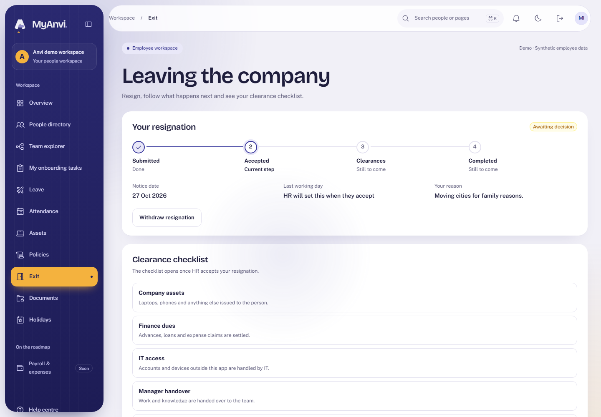
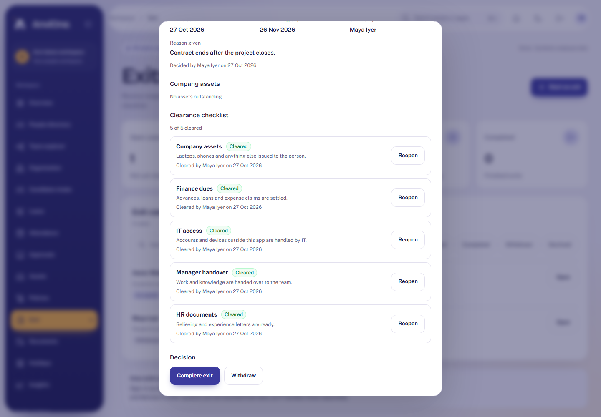
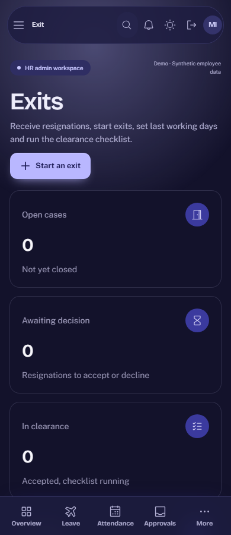

# Acceptance evidence: Employee exit

Plan: [Employee exit](../plans/employee-exit.md). Synthetic data only.

## What was verified

| Claim                                                             | Check                                                                                                                               |
| ----------------------------------------------------------------- | ----------------------------------------------------------------------------------------------------------------------------------- |
| An employee resigns, sees progress and can withdraw while waiting | Browser journey in the Employee context                                                                                             |
| HR starts an exit, accepts, clears five items and completes       | Browser journey in the HR context (another person, since HR cannot decide their own case)                                           |
| Only HR decides; people only submit and withdraw their own        | Integration: role access, employee writes refused, HR refused on their own case                                                     |
| One open case per person; stale versions conflict                 | Integration                                                                                                                         |
| Equipment must come back first                                    | Integration: the assets item cannot be cleared or waived while an asset is held; issuing to a leaver after completion is refused    |
| Completion needs every item done and the last working day         | Integration: 409 before the date unless HR gives a recorded early-release reason; clearance resets racing completion are serialized |
| Withdrawing an accepted case needs a new reason                   | Integration                                                                                                                         |
| The database holds the rules by itself                            | Integration: direct statements for employee inserts, skipped states, changing closed cases, clearance writes and deletes all fail   |
| Every change is recorded                                          | Integration: audit and outbox rows for submit, accept, reject, withdraw, clearance and complete                                     |
| Accessible and responsive                                         | Browser: axe WCAG 2.2 AA in light and dark; no sideways scroll at 390 px; the device audit includes `/exit`                         |

## Reviews

An Opus review found one high and four medium issues; all were fixed in migration 031 with tests. Two lower findings are recorded, not changed: clearance events use the clearance as aggregate, and accepting emits no per-clearance events.

## Limits

- Completing ends sign-in and stops sessions on their next request; no sessions or identity bindings are rewritten, and external systems are not touched.
- Access ends when HR completes the case, not automatically on the last working day.
- No dues calculation or settlement (needs Payroll); finance is a manual confirmation.
- The list does not show clearance progress per case; it is in the details.
