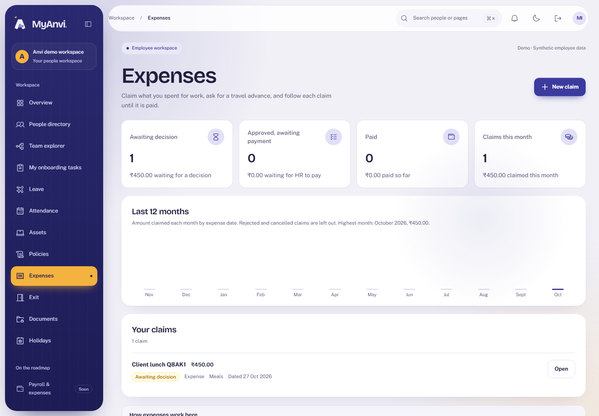
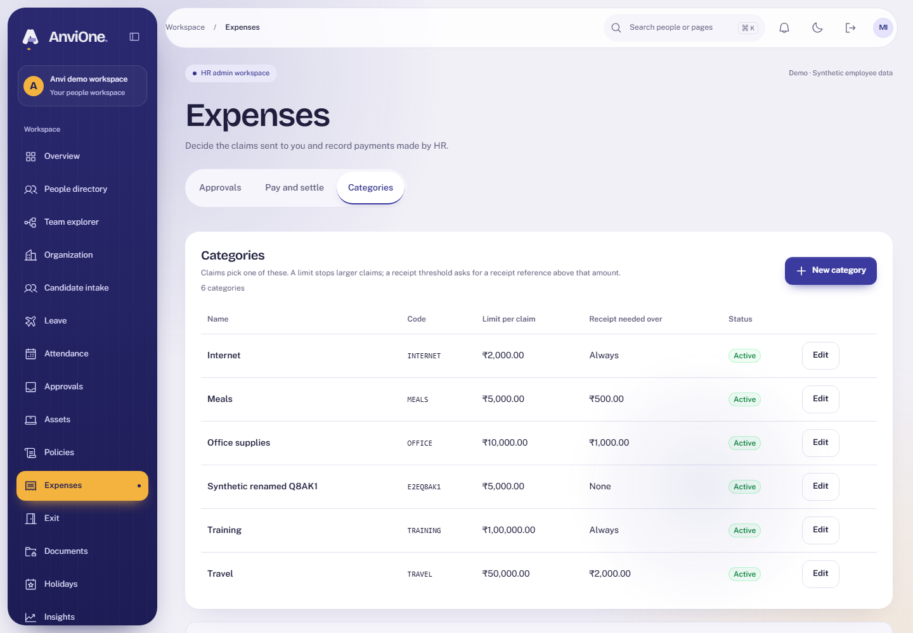
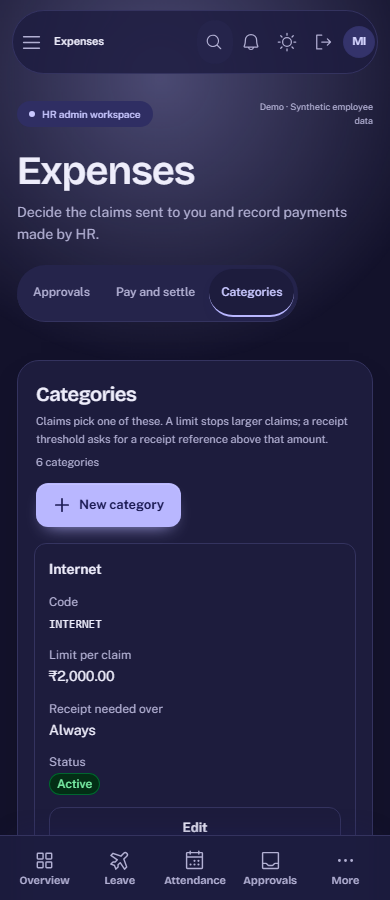

# Acceptance evidence: Expenses

Plan: [Expenses](../plans/expenses.md). Synthetic data only.

## What was verified

| Claim                                               | Check                                                                                                                     |
| --------------------------------------------------- | ------------------------------------------------------------------------------------------------------------------------- |
| An employee submits a claim, sees it and cancels it | Browser journey in the Employee context                                                                                   |
| HR adds and renames a category                      | Browser journey in the HR context                                                                                         |
| Approval and payment follow the rules               | Integration: submit, approve, pay, reject, cancel; reject needs a reason; payment needs a reference and valid date        |
| Nobody decides or pays their own claim              | Integration: manager and HR are refused on their own claims                                                               |
| Managers act only for their current reports         | Integration: team scope; after a report is reassigned the old manager loses sight and the new one can approve             |
| Limits and receipts are enforced                    | Integration: over-limit claims are refused with the limit named; receipt required above the threshold                     |
| Old claims are not rewritten by category edits      | Integration: category and manager are copied onto the claim                                                               |
| Concurrent changes are safe                         | Integration: a category update racing submissions gives no server error; stale versions conflict                          |
| The database holds the rules by itself              | Integration: direct statements for foreign inserts, editing submitted claims, self-approval, skipped states, deletes fail |
| Every change is recorded                            | Integration: audit and outbox rows for every action                                                                       |
| Accessible and responsive                           | Browser: axe WCAG 2.2 AA in light and dark; no sideways scroll at 390 px; the device audit includes `/expenses`           |

## Reviews

An Opus review found one high and three medium issues; all were fixed in migration 033 with tests. Left as is: the same HR user can approve and then pay a claim (no separation of duties).

## Limits

- No receipt upload (a reference number only), no multi-currency, no per-person caps.
- Advances are not netted against a later claim.
- "Paid" is a record HR makes; no payment is made and nothing goes to Payroll yet.
- HR files their own claims by switching to their Employee role.
- Approval and payment are covered by API tests; the browser test covers submit, cancel and categories because the demo person holds every role and cannot decide their own claim.
