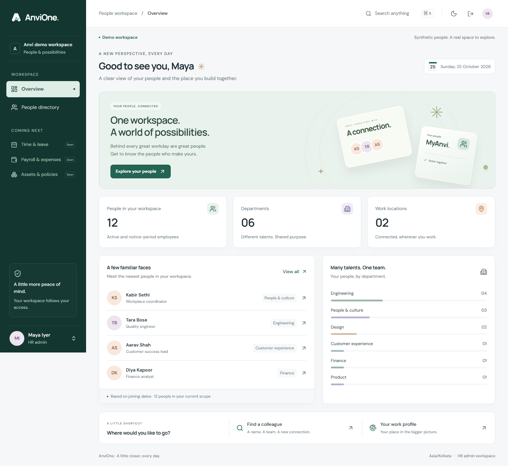

# Foundation acceptance evidence

Recorded 25 October 2026. Scope: F0.1 synthetic foundation preview. Environment: Windows/PowerShell, project Node 24.22.1, pnpm 11.21.0, PostgreSQL 18.6 in Docker, Chromium via Playwright. These checks do not approve a production rollout.

| Check                                     | Evidence                                                                                                                      |
| ----------------------------------------- | ----------------------------------------------------------------------------------------------------------------------------- |
| Strict TypeScript, lint and bundled build | `pnpm check`                                                                                                                  |
| Role/config/CSRF unit cases               | 11 tests across 3 files                                                                                                       |
| PostgreSQL/API integration                | 14 scenarios plus the parent test: 15 passing Node test results                                                               |
| Browser journeys                          | Directory/search/profile/role reduction/logout; persistent branding and audit; responsive/accessibility/reduced-motion checks |
| Responsive review                         | Screenshots at 360, 768, 1440 and 1920px; no document horizontal overflow in tested views                                     |
| Accessibility automation                  | No axe WCAG-tagged findings on login, home light/dark and directory in tested states                                          |
| Dependency advisories                     | `pnpm audit --audit-level=moderate`: no known vulnerabilities after dependency updates                                        |
| Runtime pin                               | `pnpm exec node --version`: v24.22.1                                                                                          |
| Dependency compatibility                  | `pnpm peers check`: no peer dependency issues                                                                                 |
| API image                                 | Build recipe tested with non-root runtime; production OIDC launch is not validated                                            |

Important negative scenarios: unknown identity, missing session, external origin, bad CSRF, invalid role, old session replay, employee reading another profile, manager scope, cross-entity profile, tenant context reuse, direct identity-table reads, worker employee-table reads, stale branding write, audit write failure, audit modification, duplicate outbox consumers, deactivation and absolute expiry preservation.

The staged upload passed Gitleaks v8.30.1 with redaction enabled and no leaks found. Git exclusions were checked for `.env`, scratch artifacts and the original planning prompts. The API image reports `uid=1000(node)` and Node v24.22.1.

The initial security scan found vulnerable rate-limit/transitive packages. express-rate-limit was upgraded and patched multer/ip-address versions were pinned. The current dependency check passes; this does not cover every image, runtime behavior or future advisory. The host's original Node was not changed; project scripts use the patched pinned runtime.

Visual review removed a whole-page opacity animation that temporarily lowered contrast and enlarged small text. The decorative card transforms respect reduced motion. Screenshots show synthetic records only.

## Not verified / incomplete

Live Entra sign-in, MFA policy enforcement against the real provider, full negative OIDC protocol suite, manual NVDA/VoiceOver, 200% zoom/reflow, full Safari/Firefox matrix, all palettes/routes, production TLS/CSP, distributed operation, image vulnerability scanning, SBOM/signing, independent audit archive, load/soak/restore drills, privacy/legal approval and HR UAT remain outstanding. Automated accessibility success is not a declaration of WCAG conformance.

CI configuration is committed. Its actual GitHub run result must be checked independently; a local passing command is not a passing remote run.
