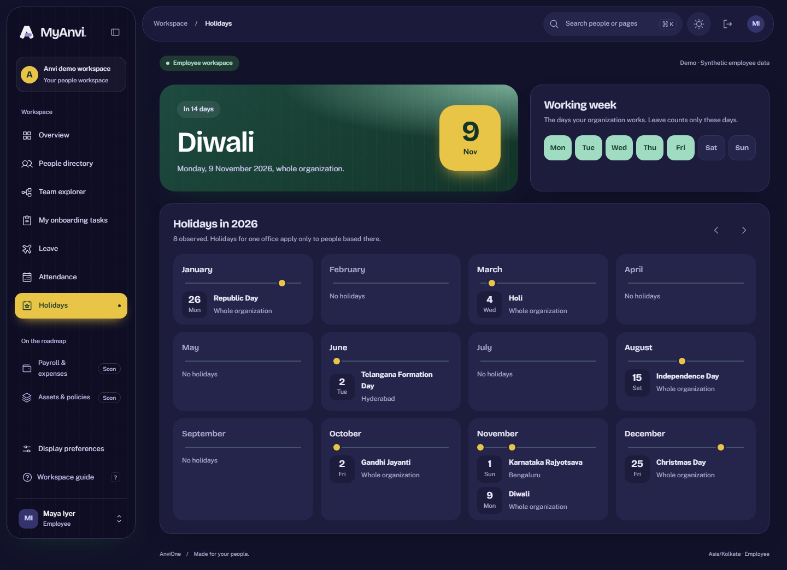

# Holiday and work-week calendar evidence

Validated 26 October 2026 against synthetic local data.

## Accepted behavior

- Every workspace reads its own entity's working week and holidays. The Holidays page shows the next holiday that applies to the viewer, with a countdown, and a 12-month view of the year.
- Only HR adds, renames and (de)activates holidays and changes the working week. Every change needs a reason, is versioned and is audited. Stale versions conflict, and the date and office of a holiday are immutable. A holiday applies entity-wide or to one active office, with at most one active holiday per date for each scope. Holidays are deactivated, never deleted.
- Leave counts business days: the working week minus active holidays that are entity-wide or for the requester's office. A Bengaluru holiday does not reduce a Hyderabad employee's leave. The request dialog counts days the same way the server does. Calendar changes affect only new requests; submitted leave keeps its recorded days.
- Attendance shows unrecorded holidays as holidays, and uses the working week instead of a fixed Saturday/Sunday weekend, for both the 30-day view and the team board.
- New legal entities start with a Monday–Friday week and the default leave types.

An independent security review found nothing exploitable and confirmed that the replaced leave guard matches its predecessor apart from the day count. Its findings (new-entity defaults, inactive offices) are fixed here.

## Honest boundary

Seeded holidays are illustrative, not a statutory list. Optional or restricted holidays, half days, shifts and regional calendars beyond one office are not implemented. Manual screen-reader, zoom, Safari and Firefox acceptance remain required.
