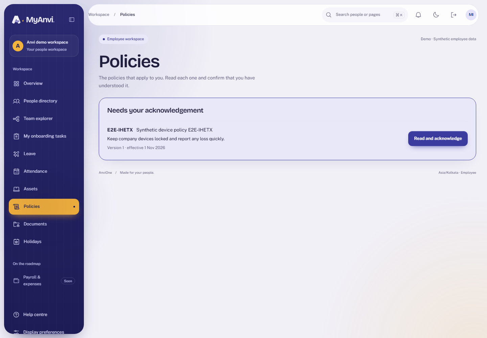
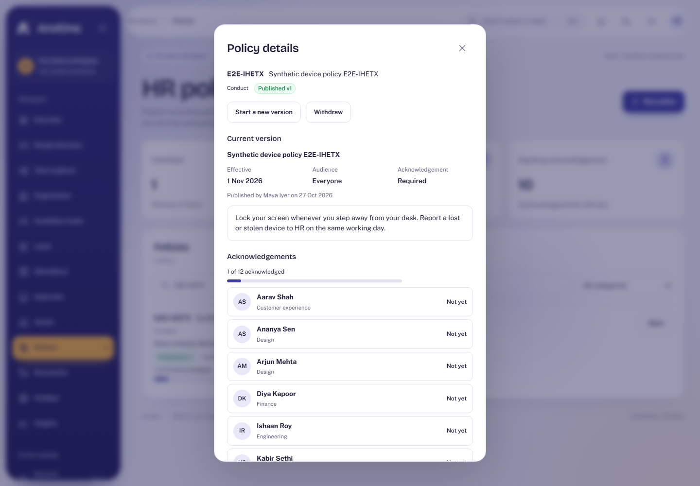
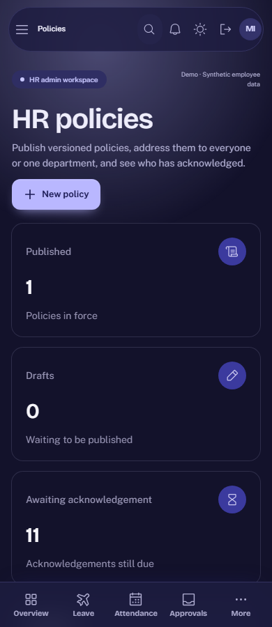

# Acceptance evidence: HR policies

Plan: [HR policies](../plans/hr-policies.md). Synthetic data only.

## What was verified

| Claim                                                          | Check                                                                                                                                   |
| -------------------------------------------------------------- | --------------------------------------------------------------------------------------------------------------------------------------- |
| HR drafts and publishes; the employee acknowledges; HR sees it | Browser journey across HR and Employee contexts; Today shows the outstanding policy                                                     |
| Only HR manages policies                                       | Integration: employees, managers and others are refused on create, edit, publish and withdraw                                           |
| People see only what is addressed to them                      | Integration: drafts and other departments' versions are invisible; acknowledging them is refused                                        |
| Acknowledgement is once and truthful                           | Integration: second acknowledgement conflicts; timestamp is set by the database; only the current published version can be acknowledged |
| Versions behave                                                | Integration: publishing supersedes the previous version; published wording cannot change; stale edits conflict                          |
| The database holds the rules by itself                         | Integration: direct statements for employee writes, forged acknowledgements, rewriting published wording and deletes all fail           |
| Every change is recorded                                       | Integration: audit and outbox rows for create, draft, publish, acknowledge and withdraw                                                 |
| Accessible and responsive                                      | Browser: axe WCAG 2.2 AA in light and dark; no sideways scroll at 390 px; the device audit includes `/policies`                         |

## Reviews

An Opus review found no critical or high issues. Applied: exact compliance totals, and department checks that no longer block supersede or withdraw (migration 028). The acknowledgement lock it suggested was tried and reverted (migration 029) because the keeper role has SELECT only; the evidence stays truthful either way.

## Limits

- Pure HR-admin identities are counted in the audience but acknowledge through the Employee role.
- No reminders (needs notification dispatch), no quizzes, no e-signature. Policy wording is supplied by HR or legal.
- The list caps at 500 versions, and new drafts are logged as `policy.draft_updated`.
