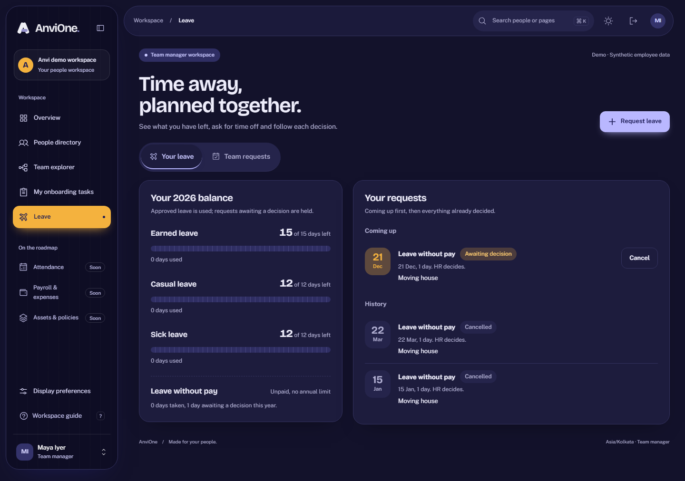

# Leave ledger and workflow evidence

Validated 25 October 2026 against synthetic local data.

## Accepted behavior

- Employees and managers see a current-year balance per leave type: annual entitlement minus approved debits plus reversals, with pending requests held. Leave without pay is unpaid and uncapped.
- A request counts Monday–Friday days, rejects weekend-only ranges, overlaps, over-balance, cross-year and over-31-day spans, and rejects mass-assigned fields such as another employee's ID.
- Requests snapshot the requester's manager. Managers decide only their direct reports' requests; requests from people without a manager route to HR. HR sees every entity request but cannot decide manager-routed ones. Nobody can decide their own leave in any role.
- Concurrent submissions for the same day commit once; concurrent approvals commit once. Stale versions return a conflict.
- Approval writes a ledger debit; cancelling approved future leave writes a reversal. The ledger and requests reject updates and deletes outside the workflow.
- Every transition commits audit and outbox records in the same transaction.
- The Loom leave screen passes the suite's WCAG 2 A/AA axe rules in light and dark mode, fits 390px without horizontal overflow, and exposes approvals as a separate tab for managers and the only view for HR.

## Evidence commands

`tests/leave.integration.ts` (11 checks), `packages/contracts/src/leave.test.ts`, and the `tests/e2e/leave.spec.ts` browser journey passed alongside the full lint, typecheck, unit, build, 62 integration and 10 browser checks.

## Honest boundary

No holiday calendar, half days, accrual, proration, carry-forward, policy administration, notification delivery, delegation or payroll/attendance effect. Leave reasons are free text, and the UI asks people to keep medical details private. Manual screen-reader, zoom, Safari and Firefox acceptance remain required before production.
