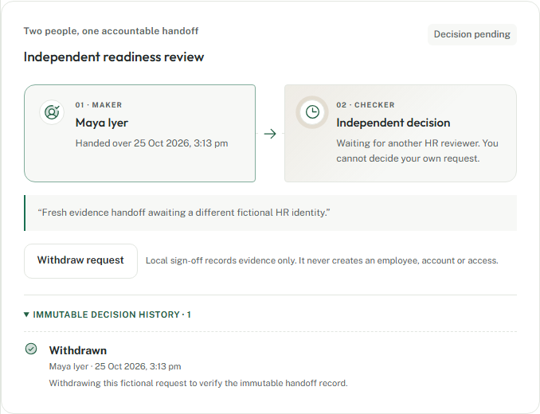

# F0.7 acceptance evidence: local-readiness maker-checker

Date: 25 October 2026. Scope: synthetic development preview only.

## Delivered

- A server-authoritative proposal gate requiring an approved form, at least one required task and completion of every required task.
- Identity-bound maker/checker enforcement: clients cannot supply actor IDs, a proposer cannot decide their own request and only the proposer can withdraw it.
- Versioned pending, approved, rejected and withdrawn records protected by FORCE RLS; terminal decisions cannot be rewritten or deleted.
- Case, workflow, audit and outbox changes committed atomically. Stale and concurrent decisions cannot both succeed.
- A responsive Atlas “decision baton” that explains eligibility, names the maker, exposes only actor-valid actions and retains terminal history.
- Plain-language boundaries throughout: local readiness is evidence sign-off, not employment activation, employee-code creation or access provisioning.

The paired maker/checker stages are the deliberate visual signature. Their connected handoff encodes the actual sequence and separation of duties rather than decorating the page with interchangeable status cards.

## Verification

- Unit and integration coverage includes strict request contracts, ineligible proposals, successful proposals, forged actor prevention, self-approval denial, maker-only withdrawal, terminal immutability, stale evidence, transaction rollback and concurrent decisions.
- Browser coverage proves the gated and eligible states, proposal dialog, maker-only withdrawal, hidden self-decision controls, immutable history, second pending request, light/dark rendering, reduced motion, automated accessibility and 320/768/1440 viewport fit.
- The activity view gives readable labels to proposal, decision and withdrawal audit actions.

## Boundary

This is one bounded workflow, not the planned configurable workflow platform. It does not provide definitions, delegation, escalation, reminders, assigned-owner workspaces or activation. Real nominated-address ownership, identity, documents/checks, approved privacy controls, transactional activation, SSO binding and employee-code issuance remain unavailable.
