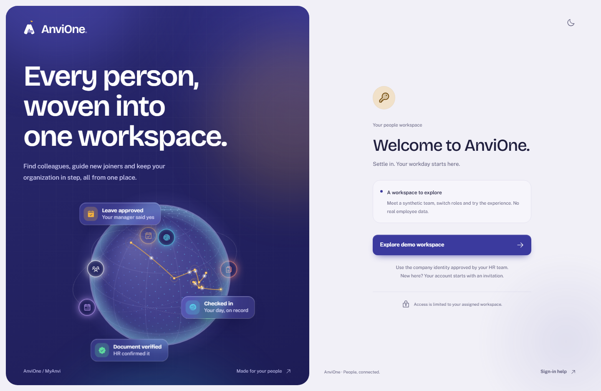
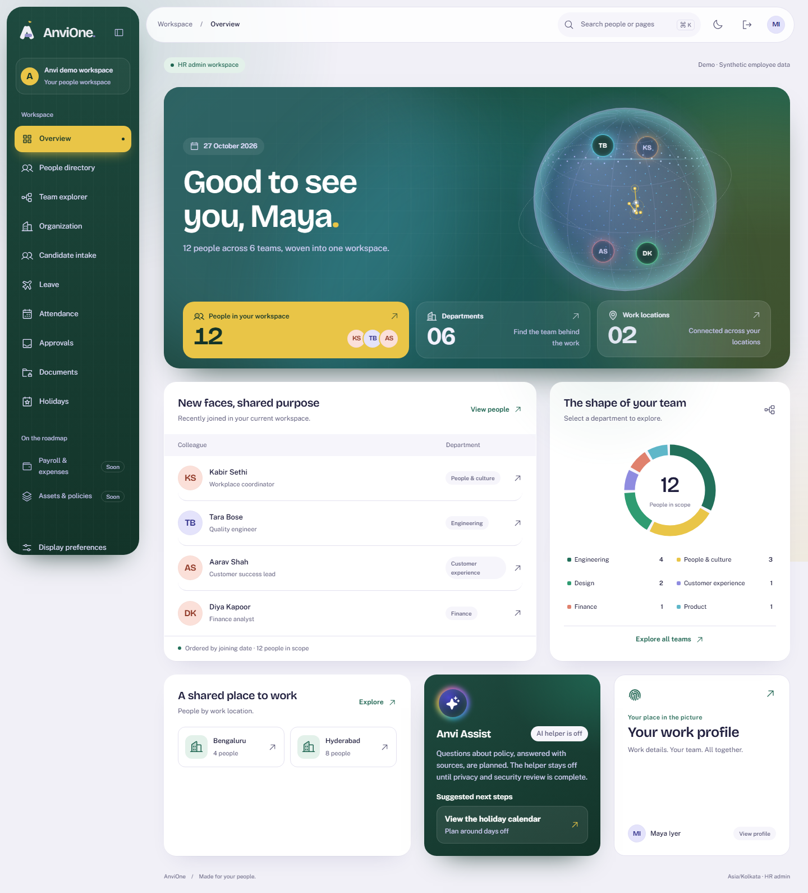
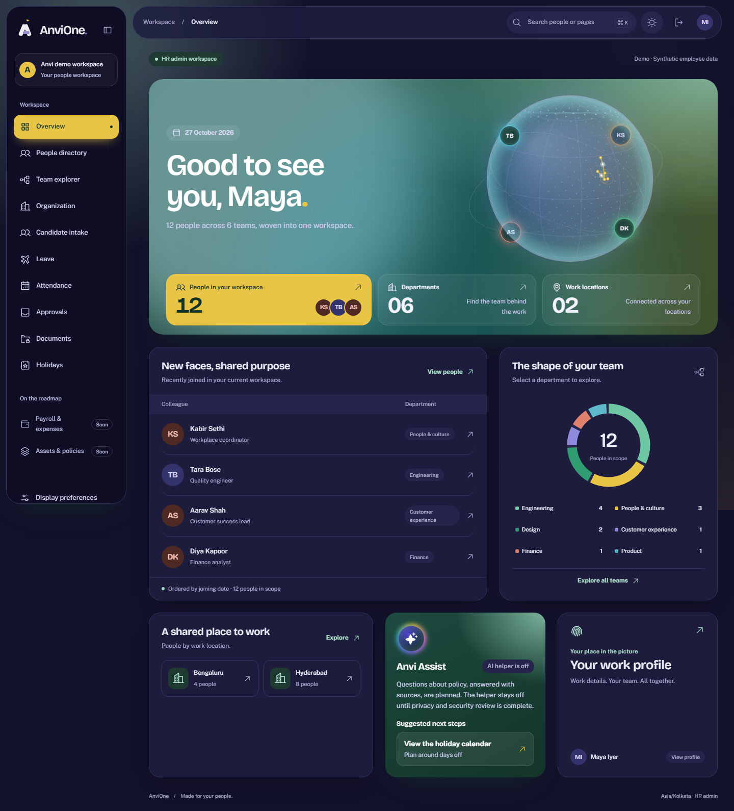

# Acceptance evidence: Loom depth and motion

Decision: [ADR 0006](../adr/0006-loom-depth.md). Synthetic data only.

## What was verified

Browser journeys in `tests/e2e/wow.spec.ts`, plus unit tests in `apps/portal/app/lib/globe-math.test.ts`:

| Claim                                                                  | Check                                                                                                                      |
| ---------------------------------------------------------------------- | -------------------------------------------------------------------------------------------------------------------------- |
| The globe is drawn                                                     | Canvas reports more than 5,000 painted pixels and `data-ready`                                                             |
| Dragging spins it, even under the orbit rings                          | Canvas frame changes after a mouse drag across the centre                                                                  |
| It rotates by itself                                                   | Two canvas frames 900 ms apart differ                                                                                      |
| Six module chips orbit and three floating cards show on sign-in        | Element counts                                                                                                             |
| The scene follows the pointer                                          | `--px` rises above 0.3 after moving to the right edge; the cursor light activates                                          |
| Home shows the globe, orbiting colleagues and settled count-up numbers | Selectors and `^\d{2,}$` text                                                                                              |
| Anvi Assist is honest                                                  | Region "Anvi Assist" shows "AI helper is off" and a non-empty "Suggested next steps" list                                  |
| Reduced motion holds still                                             | Canvas identical 800 ms apart; no animation running inside the sign-in story, backdrop or cursor light; cursor glow hidden |
| Accessible                                                             | axe WCAG 2.0/2.1/2.2 A and AA with no violations on sign-in, reduced-motion sign-in, home light and home dark              |
| Responsive                                                             | No horizontal scroll at 390 px on sign-in and home                                                                         |
| Globe maths                                                            | Points stay on the unit sphere; the chosen longitude faces front; arcs start and end on their pins                         |

The full suite also passed: format, typecheck, lint, builds, unit, integration and every browser journey, including the earlier modules.

## Limits

- The globe's offices are illustrative; the globe is not data.
- The AI helper is switched off. Suggested next steps are rules, not AI.
- Frame rate was not benchmarked on low-end devices. The loop pauses off screen and in hidden tabs and caps pixel ratio at 2.
- Manual screen-reader and real-device checks remain open under UX-02.
