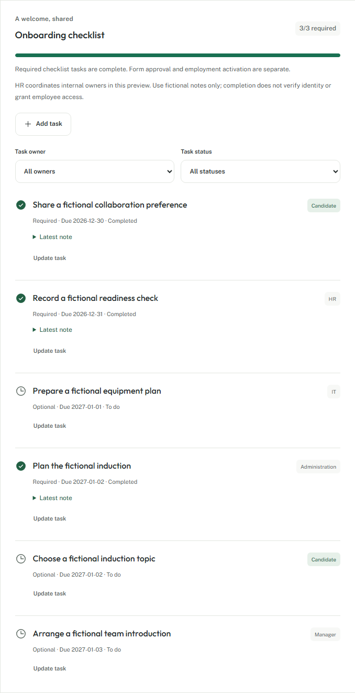
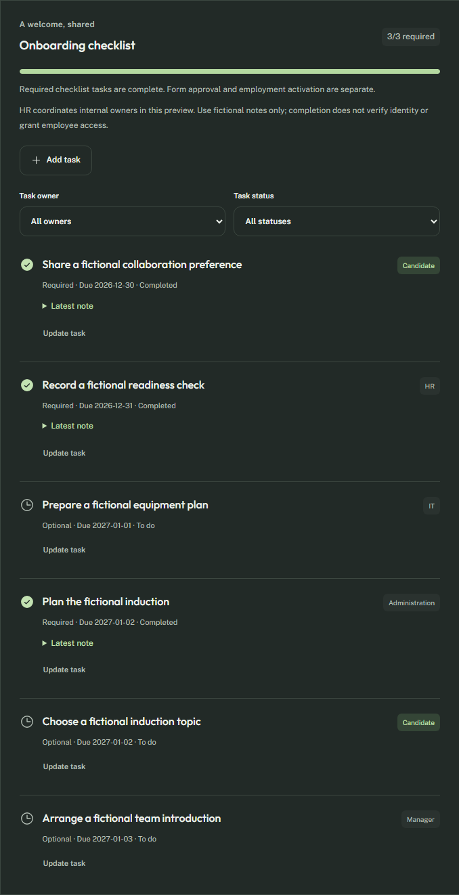
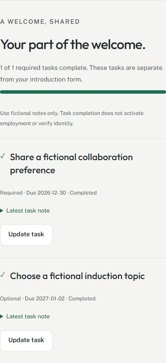
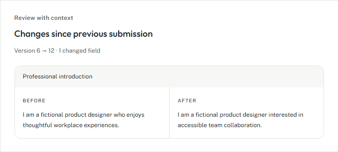

# F0.5: Onboarding checklist and comparison

25 October 2026. Synthetic development/demo preview only.

HR can explicitly start starter v1 or add up to 30 immutable task definitions per intake. Owners coordinate candidate, HR, manager, IT and administration work; internal owner workspaces are not implemented, so HR performs their updates. Tasks have joining-relative dates, required flags, same-case prerequisites and pending/blocked/completed status. Each change records a note, checks task/case versions and commits case/task/audit/outbox together. Required tasks cannot be waived or deleted. Prerequisites must be completed first; completed dependents must be reopened before their prerequisite.

Candidates see only their own tasks, can update them after form submission/approval and never receive internal prerequisite IDs or labels. A waiting flag and HR support message explain a blocked dependency. Candidate checklist writes can increment the case version but cannot modify approved form data. Invitation rotation/revocation and cancellation retain their existing security boundaries. Checklist completion and form approval grant no employee record, code or access.

HR sees named before/after fields between the latest two immutable submissions, with the full snapshots retained in history. Text is rendered through React without HTML injection. Checklist owner/status filters, required progress, focused dialogs and inline candidate controls work on narrow layouts. Completion feedback respects reduced motion, and candidate keyboard focus returns to the updated task.

Validation:

- `pnpm check`: lint, TypeScript, 23 unit checks and both portals/API/worker builds pass.
- `pnpm test:integration`: 48 results pass (44 scenarios, four parent tests). Added cases cover simultaneous starter application, role/entity isolation, candidate owner restrictions, metadata/case forgery, audit rollback, concurrent completion after form approval, dependent reopening rules, foreign-case prerequisites, the 30-task limit and cancellation. The outbox regression now handles more than two pending batches while still proving exactly one receipt per event and harmless replay.
- `pnpm test:e2e`: nine Chromium journeys pass, including expanded onboarding with starter/custom task creation, dependency UI, candidate completion, HR coordination, filters, correction comparison, focus restoration and reduced-motion feedback. New HR panels pass axe in light/dark and at 320/768/1440 widths; candidate layouts are checked at 320/390/768/1440.
- Formatting, generated OpenAPI contracts, dependency audit and restricted API-container smoke pass. No new dependency was needed.

Remaining: real nominated-email ownership/delivery, complete necessary forms and approved privacy notices, private scanned documents, actual check evidence/verification, named internal assignees and permissions, template administration, escalations/reminders, shared maker-checker workflow, transactional employee activation/initialization and production security/privacy/operations gates. Synthetic notes are not verified identity evidence, legal consent or compliance certification.

See [implementation plan](../plans/onboarding-checklist.md), [backlog](../backlog.md), [coverage map](../requirements-traceability.md) and [candidate contract](../api/candidate-openapi.json).
