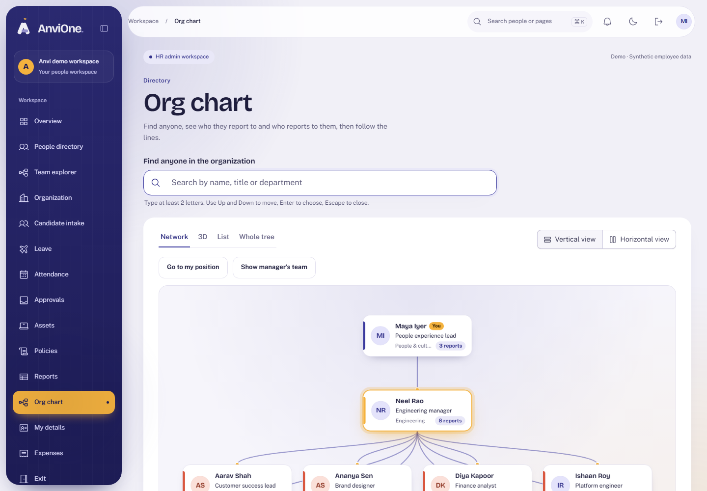
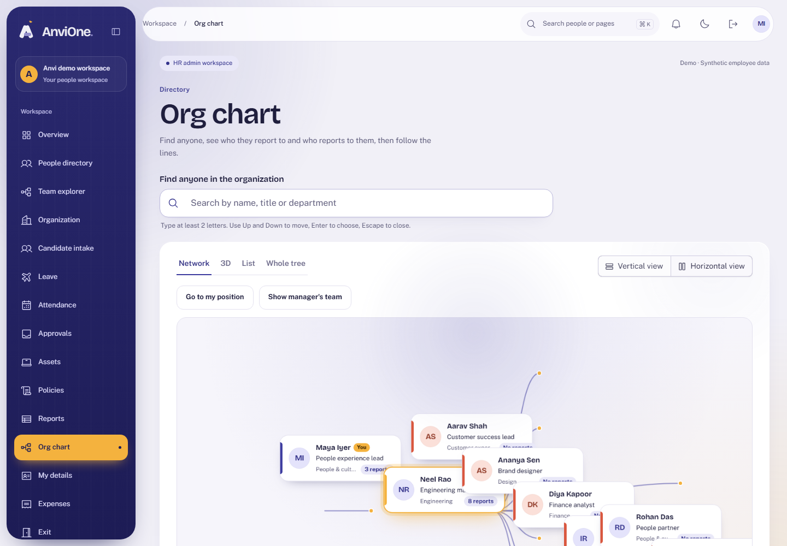
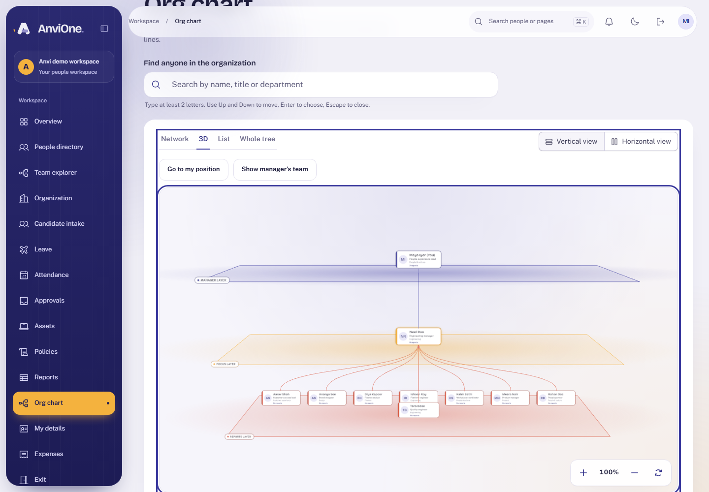

# Acceptance evidence: Org chart visualisation

Decision record: [ADR 0009](../adr/0009-org-chart-visualisation.md). Synthetic data only.

## What was verified

| Claim                                                                   | Check                                                                                                                                                                               |
| ----------------------------------------------------------------------- | ----------------------------------------------------------------------------------------------------------------------------------------------------------------------------------- |
| Anyone can search the organization and open a colleague's neighbourhood | Browser (HR and Employee): search, pick a result, see the manager above and the direct reports below; the URL carries `?focus=`                                                     |
| Vertical and horizontal views                                           | Browser: toggle both ways; the choice is remembered                                                                                                                                 |
| Zoom by mouse and keyboard                                              | Browser: on-screen buttons and the `+`, `-` and `0` keys change the shown zoom percentage; wheel, drag, pinch and arrow-key pan are supported                                       |
| 3D layered view                                                         | Browser: lazy-loaded tab renders without console errors; falls back to the network view when WebGL is unavailable                                                                   |
| Accessible equivalent                                                   | Browser: List view lists manager, person and reports as buttons; axe WCAG 2.2 AA in light and dark on Network, List and 3D                                                          |
| Only seven fields are exposed                                           | Integration: id, name, initials, title, department, manager link, report count; no email, code, location, dates or status                                                           |
| Hidden people stay hidden                                               | Integration: inactive people and other entities never appear; unknown and other-entity ids return the same 404                                                                      |
| Abuse is limited                                                        | Integration: 120 searches and 120 lookups a minute per person, not reset by role switch or new session; 2 s function timeout; sessions without an employee record are refused (403) |
| The database holds the rules                                            | Integration: functions owned by a minimal keeper role, execute only for the app role, refuse without a valid session context                                                        |
| Responsive                                                              | Browser: no sideways page scroll at 390 px; the device audit includes `/chart`                                                                                                      |

## Reviews

An Opus review found nothing high-severity. The two medium findings (a shared rate-limit bucket and a 500 for sessions with no employee record; the database trusting an unchecked session employee id) and two lower ones (search cost timeout, department join hiding people) are fixed in migration 042 with tests.

## What this deliberately widens

Before this slice an employee saw only themselves on the chart and a manager only their direct reports. Now every signed-in person with directory access can search any active or notice-period person in their own legal entity and see seven basic fields, and can walk the reporting structure one level at a time. Contact details, codes, locations and dates are not exposed. This follows your request and is recorded in ADR 0009; if you want it limited later, it is two functions and one permission.

## Limits

- The 3D view draws at most 48 reports and shows the rest as "+N more"; the list and search cover everyone.
- Wheel and touch over the chart canvases zoom the chart instead of scrolling the page.
- The horizontal 3D layout and touch pinch were checked by screenshots and automation, not on a real device.
- Search is not indexed (entities are small); trigram indexes are the next step if they grow.
