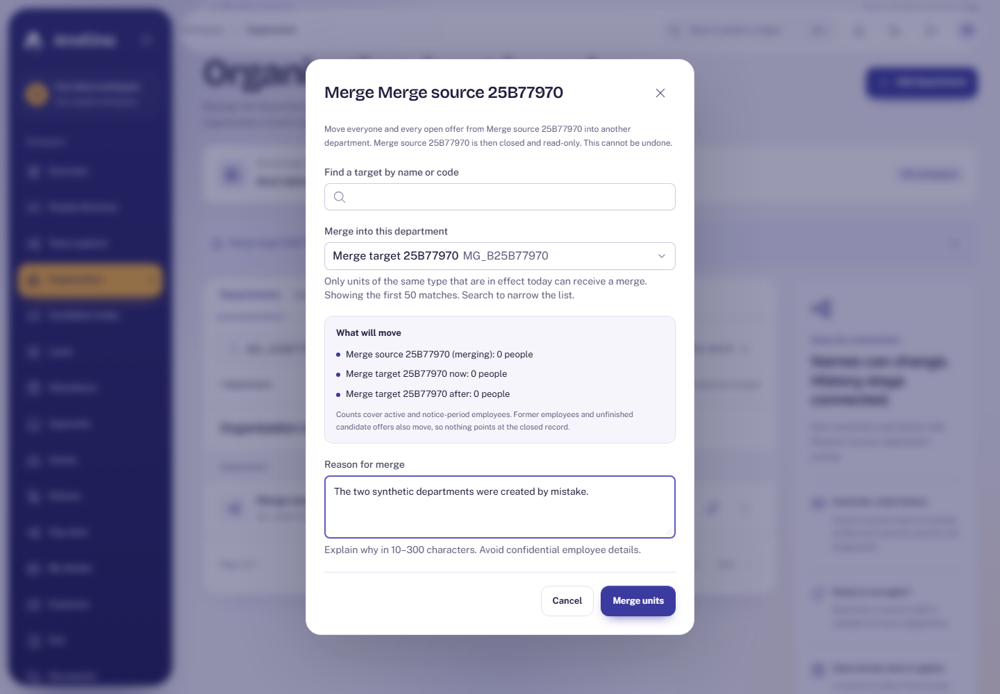
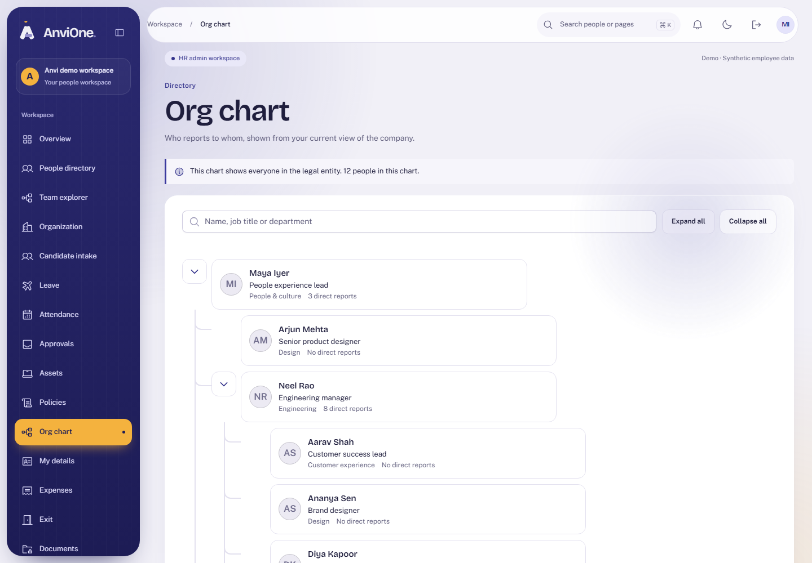
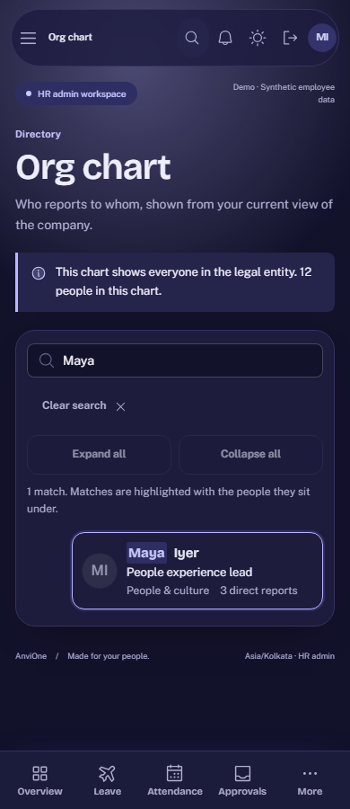

# Acceptance evidence: Organization masters, merges and chart

Plan: [Organization masters, effective dates, merges and chart](../plans/organization-masters-and-chart.md). Synthetic data only.

## What was verified

| Claim                                                    | Check                                                                                                                                       |
| -------------------------------------------------------- | ------------------------------------------------------------------------------------------------------------------------------------------- |
| HR creates two departments and merges one into the other | Browser journey: reason required, result counts shown, the closed record shows where it went                                                |
| Merge is safe and complete                               | Integration: people, former employees and unfinished candidate offers move; the source is closed for ever; counts audited                   |
| Merge refusals                                           | Integration: same record, different kinds, target not in effect, stale versions (both required), policies or holidays still in use          |
| Races                                                    | Integration: merge versus assignment and versus another merge serialize without deadlock                                                    |
| More masters and effective dates                         | Integration: designations, grades and cost centres; scheduled, in effect and ended windows; assignment refused for units not in effect      |
| Ending a used unit is refused                            | Integration: 409 pointing HR to merge                                                                                                       |
| The chart never widens directory access                  | Integration: HR sees the entity, a manager sees themselves and direct reports, an employee only themselves; hidden managers are never named |
| The chart is safe                                        | Integration: reporting loops are broken, depth and 2,000-person caps flag `truncated`                                                       |
| The database holds the rules by itself                   | Integration: direct statements to change employee organization columns or merge links fail                                                  |
| Accessible and responsive                                | Browser: axe WCAG 2.2 AA in light and dark on organization and chart; no sideways scroll at 390 px; device audit includes `/chart`          |

## Reviews

An Opus review found nothing critical. Medium findings (a merge leaving policy audiences, holidays and candidates behind; a null version skipping the check) and the lower ones were fixed in migration 038 with tests.

## Limits

- Designations, grades and cost centres are masters only; employees cannot be assigned to them yet.
- Managers see one level and employees only themselves on the chart, because directory access is not widened.
- A merge also moves former employees, so nothing points at a closed record.
- The chart is capped at 2,000 people and 20 levels and says when it is partial.
