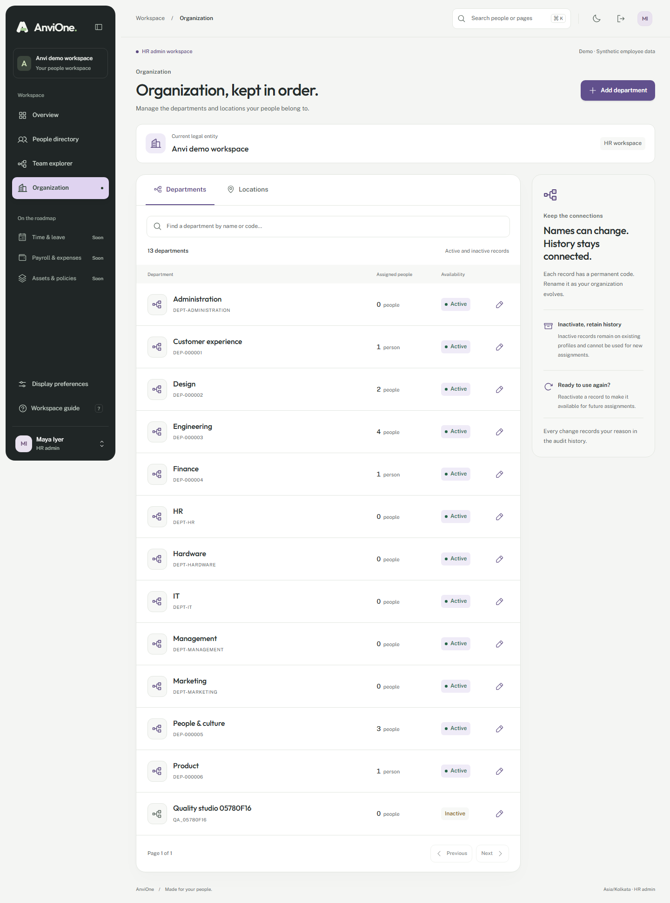

# People and organization acceptance evidence

Recorded 25 October 2026. Scope: F0.3 synthetic foundation. Environment: Windows/PowerShell, Node 24.22.1, pnpm 11.21.0, PostgreSQL 18.6 and Chromium. [ADR 0003](../adr/0003-people-organization-identity.md) records the model, access policy and deployment boundary.

## Results

| Check                                                  | Measured result                                                                                                                        |
| ------------------------------------------------------ | -------------------------------------------------------------------------------------------------------------------------------------- |
| Format, ESLint, strict TypeScript and production build | Passed locally                                                                                                                         |
| Unit tests                                             | 17 passing across four files                                                                                                           |
| PostgreSQL/API integration                             | 31 scenarios plus three parent results: 34 passing                                                                                     |
| Browser regression                                     | Eight journeys passed together against the built portal                                                                                |
| Dependency audit                                       | No known vulnerabilities at moderate threshold                                                                                         |
| Peer dependencies                                      | No issues                                                                                                                              |
| Migration and seed repeat                              | 003/004 applied to the existing synthetic database; migration/seed reruns completed without recreating employees or resetting branding |
| Identity CLI                                           | `--help` and default dry-run from a private synthetic JSON file completed; dry-run returned `ready`, no binding                        |

The original 12-person directory, fixed UUIDs/codes, self scope, direct-manager scope and entity isolation remain covered. The schema no longer stores repeated name/initial/department/location text on employment. The invoker-security directory view reads the canonical records under RLS.

Organization tests cover HR-only access, ungranted HR context, input/mass-assignment validation, CSRF/origin, foreign entities, case-insensitive uniqueness, concurrent version conflict, immutable master codes, referenced-delete rejection and rollback when audit or outbox insertion is denied. Allocation tests cover concurrent same-request replay, distinct reservations, forbidden runtime allocation/reset, immutable codes, rollback gaps, rehire using the same person, retained tombstones and rejection of unissued/recycled codes and inactive/foreign/wrong-kind assignments.

Identity tests use only a dedicated operator connection against synthetic employment. They verify source-table access denial, runtime/worker/migration-call denial, empty dry-run effects, evidence/email/scope/eligibility checks, future joining dates, ambiguous official email, rollback on audit failure, concurrent exact replay, one Employee-only binding, safe conflict behavior and no subject/email in audit metadata or output errors. Test-created bindings are removed by the privileged fixture teardown; no real corporate identity was bound.

The new browser journey creates and edits departments/locations, exercises a real two-window stale edit, reloads the latest version, changes availability, checks read-only codes, validates reasons, searches via URL, verifies role denial and inspects the audit reason. Synthetic browser-created masters remain inactive for audit continuity. Existing role, directory, profile, branding, command, palette and motion journeys pass as well.

Organization overflow checks cover 320, 768, 1440 and 2560px. Axe WCAG-tagged checks cover the Organization page in the persisted Iris light/dark palette, mobile layout and create dialog. Existing core-page palette coverage remains in the Atlas suite. Screenshots were visually reviewed on desktop and mobile; live Chrome also loaded the delivered Organization route. This is tested-state coverage, not a WCAG conformance declaration.

Review found and corrected an ambiguous PL/pgSQL column in binding replay, a form label that included its help text, HTML pattern escaping and transient sidebar contrast during navigation. Palette coverage uses normal client navigation and checks for throttled responses; CI retains only synthetic failure context/screenshots for diagnosis. The completed suite was rerun after those corrections.

## Screenshots

[Mobile workspace](organization-mobile.png) · [Dark workspace](organization-dark.png)

## Remaining acceptance

The uploaded commit's GitHub workflow must independently pass, including a fresh database install and API image smoke test. Live Entra, MFA policy, external HR/identity verification, candidate-origin invitations/OTP, completed onboarding/activation, privileged role administration and rehire identity transfer remain separate gates. No real data is approved. Manual screen-reader/zoom, Safari/Firefox, production TLS/secrets, restore drills, independent issuance/audit retention and legal/HR acceptance remain outstanding.

Migration 003 changes employment storage and needs its matching application; there is no validated old-API rollback. Production rollout must use the coordinated maintenance and recovery plan in the ADR/runbooks.
