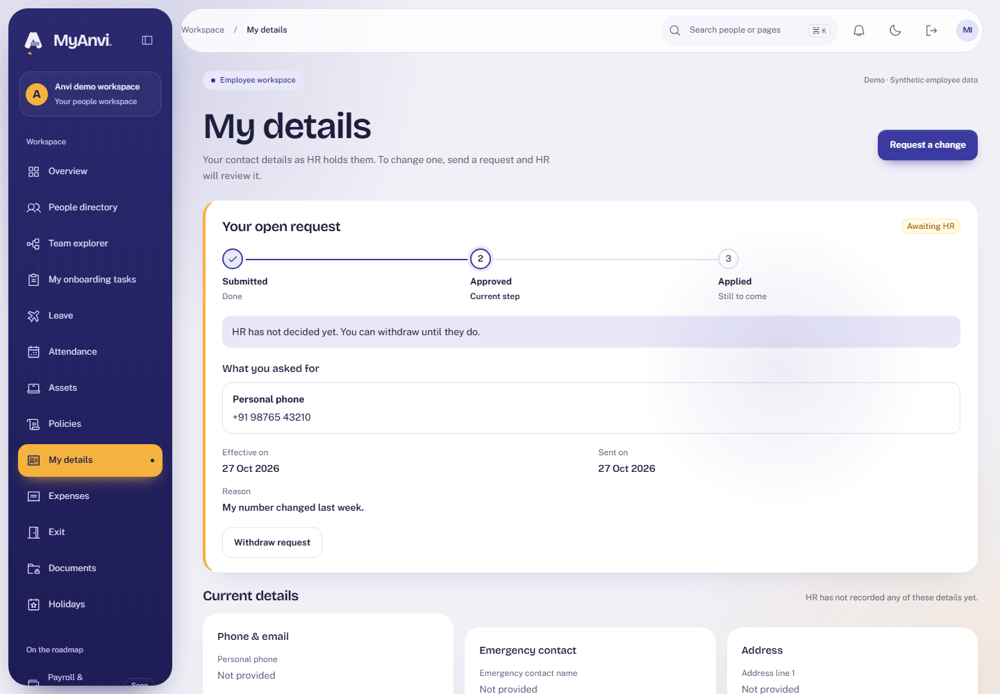
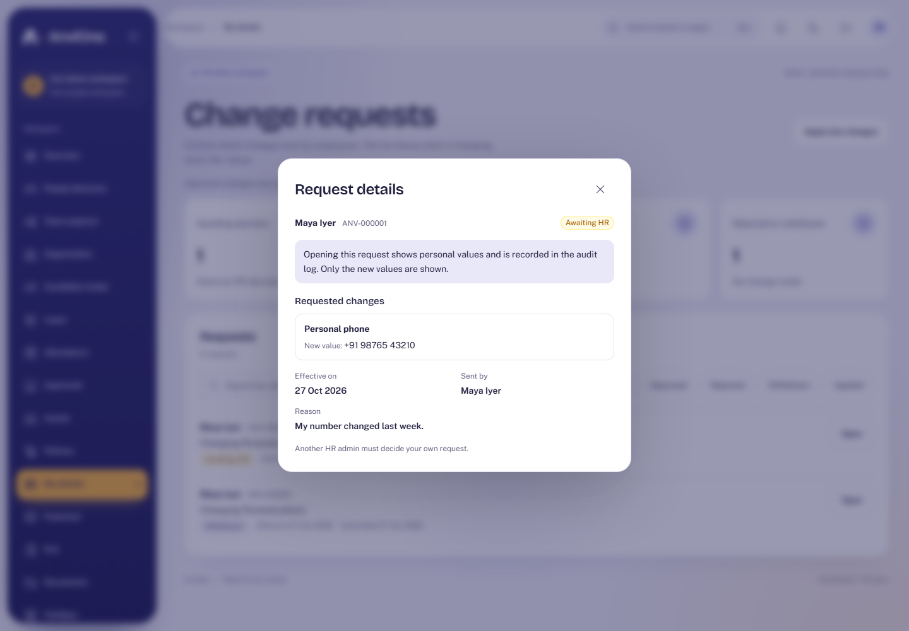
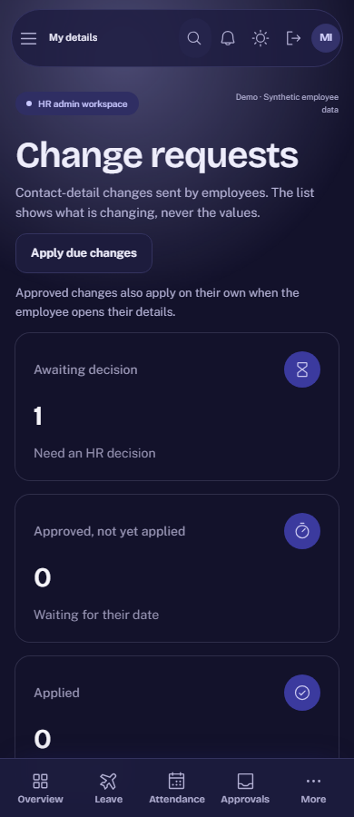

# Acceptance evidence: Personal details changes

Plan: [Personal details changes](../plans/profile-edits.md). Synthetic data only.

## What was verified

| Claim                                                   | Check                                                                                                                |
| ------------------------------------------------------- | -------------------------------------------------------------------------------------------------------------------- |
| An employee asks for a change, withdraws and asks again | Browser journey in the Employee context                                                                              |
| HR sees requests with no personal values in the list    | Browser: the phone number never appears in the HR list; values show only in the audited details dialog               |
| Nobody decides their own request                        | Browser: Approve is hidden with an explanation; Integration: the database refuses it                                 |
| Approval applies the change and keeps history           | Integration: approve and apply today, future-dated apply when due, history rows, one apply under concurrent reads    |
| Withdraw and cancel work                                | Integration: withdraw while submitted or approved-not-due, HR cancel with a note, races end with one outcome         |
| Personal data is protected                              | Integration: only ciphertext in the database, no values in audit or outbox rows, tampered values show as unavailable |
| Managers cannot see anyone's details                    | Integration: 403 through the API and no rows through direct reads                                                    |
| HR reads of personal data are audited                   | Integration: request detail and employee profile views write audit rows                                              |
| The database holds the rules by itself                  | Integration: direct statements to write profiles, history or other people's requests fail; history cannot change     |
| Accessible and responsive                               | Browser: axe WCAG 2.2 AA in light and dark; no sideways scroll at 390 px; the device audit includes `/details`       |

## Reviews

An Opus review found no critical or high issues. Medium and low findings (cancelling an approved future change, unreadable values failing the whole page, apply lock order, missing key version marker, notes in lists) were fixed in migration 036 with tests. Left as is: applying due changes happens on read as well as on demand, and two outbox events share a version when a due change is approved and applied together.

## Limits

- Only contact details can change; no names, job details or bank details, and no proof documents.
- Future-dated changes apply when the details are opened or HR runs "apply due changes", not on a schedule.
- No key rotation yet; if the key changes, old values cannot be read.
- Approving and applying is covered by API tests; the browser test covers requesting, withdrawing and HR review because the demo person holds every role and cannot decide their own request.
