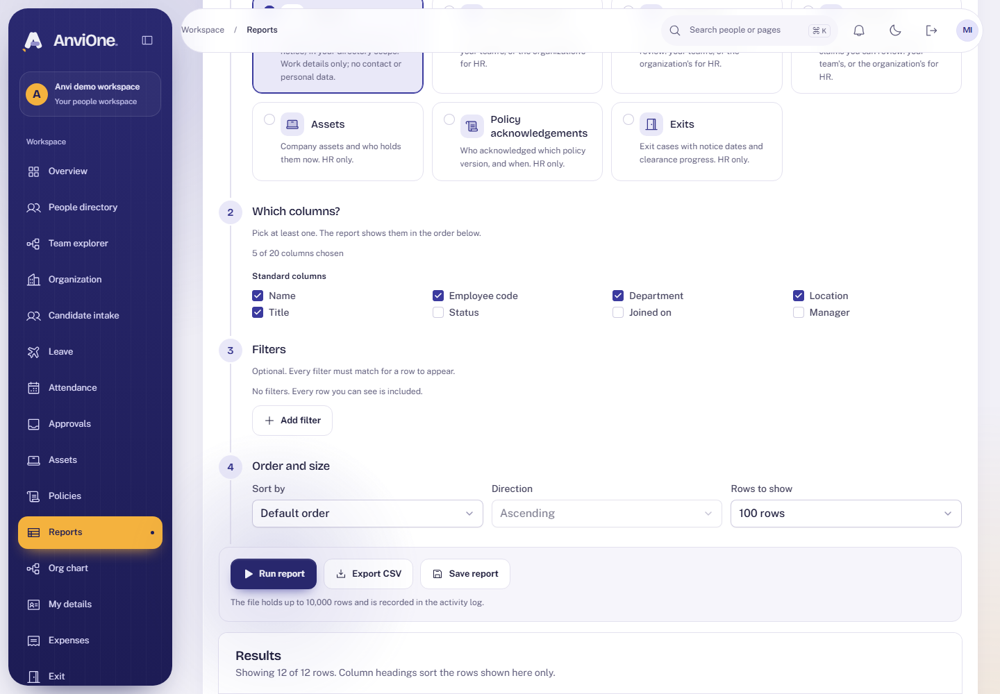
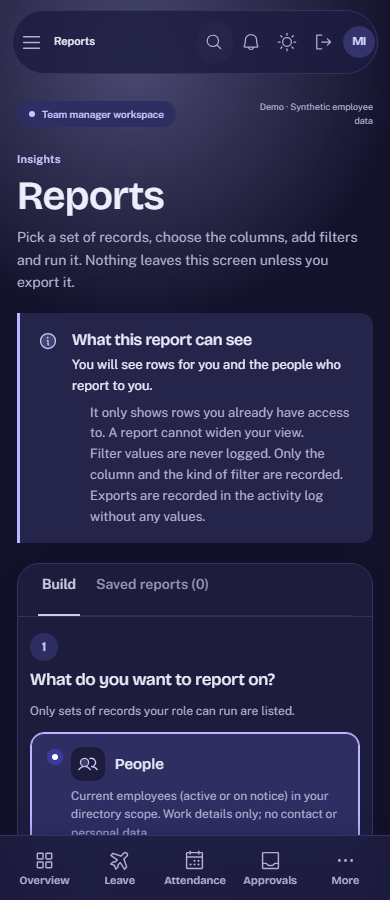

# Acceptance evidence: Report builder and exports

Plan: [Report builder and exports](../plans/report-builder.md). Synthetic data only.

## What was verified

| Claim                                                 | Check                                                                                                                                            |
| ----------------------------------------------------- | ------------------------------------------------------------------------------------------------------------------------------------------------ |
| HR builds, runs, saves, exports and archives a report | Browser journey; the downloaded file starts with a UTF-8 byte-order mark and has a safe file name                                                |
| A manager sees a narrower catalog and cannot export   | Browser: no HR-only datasets, no export button, an honest line that exports are for HR; Integration: 403 on export                               |
| Reports never show more than the domain screens       | Integration: team rows only for managers; rows follow the domain's own access rules; exited employees and merged departments still appear for HR |
| Sensitive fields are HR only                          | Integration: sensitive columns refused as columns, filters and sort for managers; never selected by default                                      |
| No injection through definitions                      | Integration: unknown columns, operators and datasets rejected; values bound; `%` and `_` matched literally                                       |
| CSV is safe in spreadsheets                           | Integration: golden cases for `= + - @`, tabs and newlines, leading spaces, fullwidth lookalikes, quotes and commas                              |
| Exports are recorded without values                   | Integration: audit and outbox rows hold dataset, column keys, filter operators and row count, never filter or cell values                        |
| Abuse is limited                                      | Integration: 60 runs and 10 exports a minute per person, not reset by role switch or new session; 8 KB definition cap; 3 s query timeout         |
| Saved reports are private and safe                    | Integration: owner only, 50 cap, unique names, archive is final, definitions hidden when the role can no longer run them                         |
| The database holds the rules by itself                | Integration: direct statements for other owners' rows and deletes fail                                                                           |
| Accessible and responsive                             | Browser: axe WCAG 2.2 AA in light and dark; no sideways scroll at 390 px; the device audit includes `/reports`                                   |

## Reviews

An Opus review found nothing critical. Medium and lower findings were fixed with tests: a rate limit on running reports and a cap on the count query, rows no longer vanish when joining the directory, stronger CSV lookalike handling, a clear message for oversized definitions, and saved definitions hidden when no longer runnable.

## Limits

- No shared or scheduled reports; CSV only; one sort, no grouping, totals or OR filters.
- The people dataset covers active and notice-period employees only.
- Exports are built in memory and bound by the statement timeout; the file says nothing about truncation, so the screen shows a warning from a response header.
- The total on screen is a guide, not an exact snapshot, and stops at 10,001.
