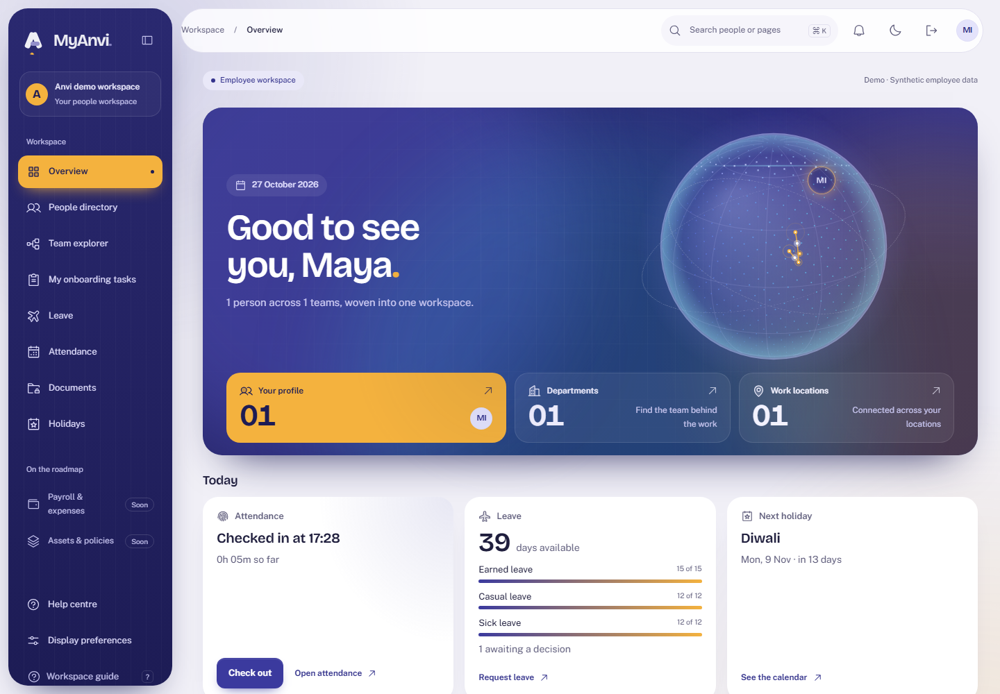
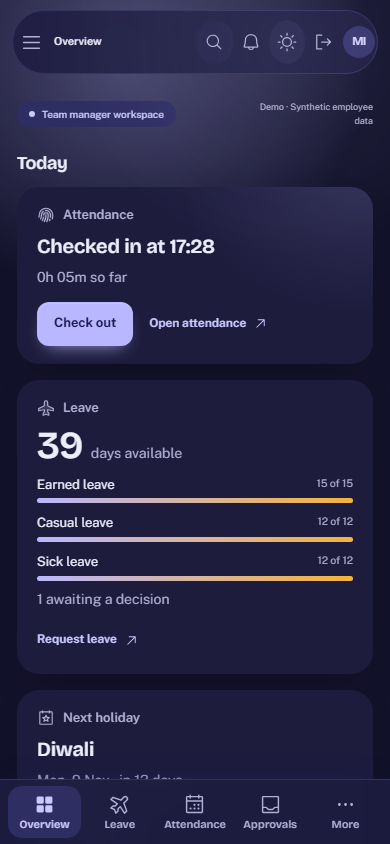
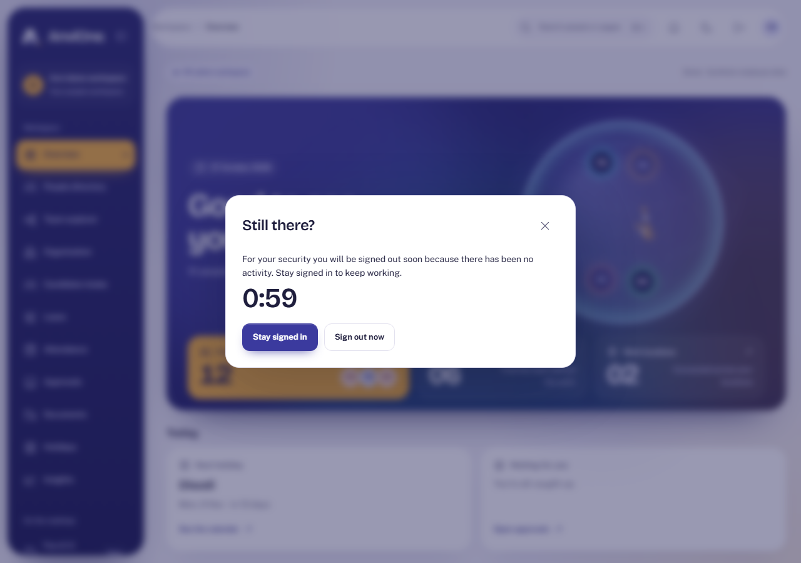
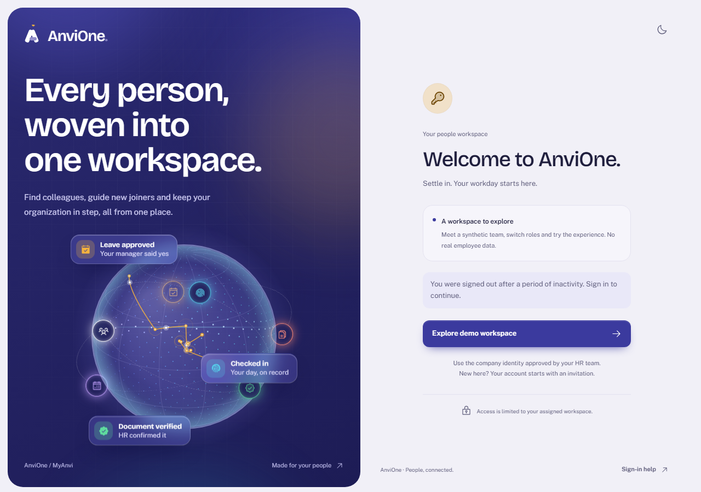

# Acceptance evidence: Today panel and idle sessions

Plans: [Home Today panel](../plans/home-today.md) and [Idle sessions](../plans/session-idle.md). Synthetic data only.

## What was verified

| Claim                                                               | Check                                                                                                                                                                               |
| ------------------------------------------------------------------- | ----------------------------------------------------------------------------------------------------------------------------------------------------------------------------------- |
| Each role sees the right Today cards                                | Browser: HR sees next holiday and waiting decisions but no punch button; an employee sees attendance, leave with a settled count-up number and no waiting card; a manager sees both |
| Check-in works from the home screen                                 | Browser: checks in when the day is still open, otherwise shows the recorded state; the punch rules themselves are covered by `attendance.integration.ts`                            |
| The panel is accessible and responsive                              | Browser: axe WCAG 2.2 AA in light and dark; one column and no sideways scroll at 390 px; Today comes before the banner on phones                                                    |
| Background polling no longer keeps a session alive                  | Integration against the real database rules: a request marked idle validates but does not refresh `last_seen_at`; a normal request does                                             |
| The idle limits are enforced exactly                                | Integration: employee and manager valid at 29 and expired at 31 minutes; HR admin, platform admin and auditor valid at 14 and expired at 16; polling alone cannot extend            |
| The portal knows each role's limit                                  | Integration: `/me` reports 1800 and 900 for the right roles                                                                                                                         |
| People are warned, can stay, and are signed out with an explanation | Browser with a fake clock: warning at 14 minutes of inactivity for HR, accessible; Stay signed in closes it; 16 more idle minutes sign out to a login screen that explains why      |
| Normal work never triggers the warning                              | Browser: navigating between screens shows no dialog                                                                                                                                 |

Final run before the last review fix: format, typecheck, lint and builds clean; 48 unit, 122 integration and 25 browser tests passed. After applying the review's low finding, the idle integration test was re-run (6 of 6).

## Reviews

An Opus security review of the idle-session change found no critical, high or medium issues. Its low finding, that writes should always count as activity whatever the header says, is applied.

## Limits

- The check-out button on the Today panel is wired to the existing endpoint but not exercised by the browser test, to avoid completing the shared demo day.
- The warning uses the portal's own clock for timing; the database stays the authority, so a wrong estimate can only warn early or late, never extend a session.
- The 8 hour absolute lifetime is not shown to the person; access reviews and configurable limits remain open under IAM-05.
