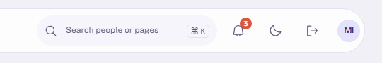
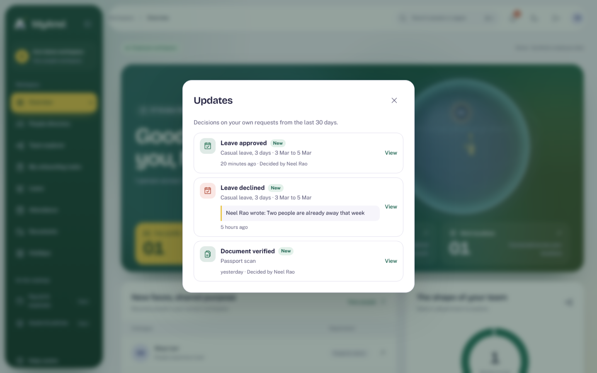

# Acceptance evidence: Updates feed

Plan: [Updates feed](../plans/updates-feed.md). Synthetic data only.

## What was verified

| Claim                                                   | Check                                                                                                                                                     |
| ------------------------------------------------------- | --------------------------------------------------------------------------------------------------------------------------------------------------------- |
| An employee sees only their own decisions, newest first | Integration: planted approved and declined leave, a declined correction and a verified document appear in that order with note, reviewer, title and dates |
| Nothing else leaks in                                   | Integration: a 45-day-old decision, a pending request, a cancelled request and a colleague's approved request never appear                                |
| A manager's wider row access does not widen the feed    | Integration: the colleague's decided request is absent in the manager context                                                                             |
| Roles without personal requests get nothing             | Integration: auditor and platform admin receive an empty feed; anonymous callers get 401                                                                  |
| The bell is usable and accessible                       | Browser: opens and closes by keyboard, axe WCAG 2.2 AA in light and in dark on a 390 px phone, no sideways scroll                                         |
| The populated layout reads clearly                      | One-off check with planted records: count 3 on the bell, outcome headline, dates, highlighted note, relative time and a New marker                        |

Final run results are in the commit message and the ADR trail.

## Limits

- In-app only: no e-mail, push or other external delivery.
- In the HR context the feed is empty because HR does not request leave there; switch to Employee to see your own.
- The remembered "last seen" time is per browser; reading on another device marks nothing there.
