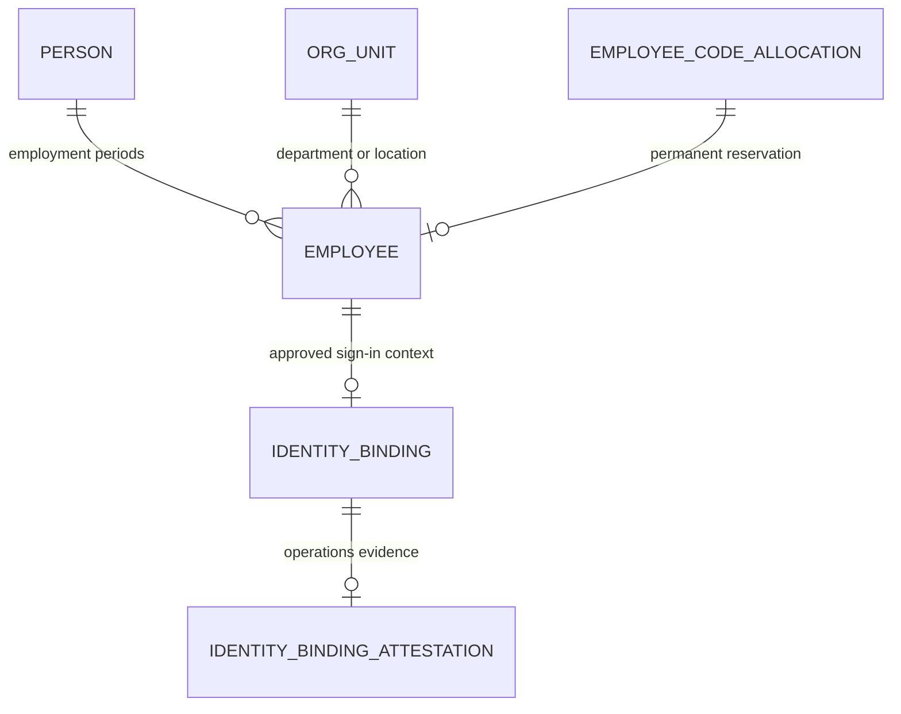

# ADR 0003: People, employment and controlled identity operations

Accepted for the F0.3 synthetic foundation, 25 October 2026.

The next activation milestone depends on stable person identity, permanent employment codes and controlled organization assignments. The foundation's `employee` row combined those concepts and stored department/location labels repeatedly. Deepen that model while preserving every existing employment UUID, employee code, identity binding and HTTP profile shape.

`person` owns the person's name and initials. The existing `employee` table remains the canonical employment instance, with a person reference and typed, same-entity department/location references. A rehire can share a person and receive a different employment/code. `employee_directory` is an invoker-security view over these records, so existing self, direct-manager and entity RLS still apply. It is a compatibility read model, not a second employee store.

HR may create, rename, inactivate and reactivate scoped departments/locations. Codes, kinds and scope are immutable; referenced masters cannot be deleted. Inactivation preserves existing profile references while locking out new assignments. Every actual HTTP mutation requires a reason and optimistic version, with audit before/after metadata and an outbox event in the same transaction. Outbox uniqueness now includes aggregate ID so unrelated records can each have version 1.

Employee-code issuance uses a database sequence and append-only allocation ledger. A composite foreign key prohibits unissued codes and assigning an old reservation to another employment. Allocation replay returns the same code; failed transactions consume a sequence gap. Application, worker and identity-operator credentials cannot allocate, edit allocations or reset the sequence. The allocator is an internal prerequisite; there is no employee-creation or activation HTTP resource in this increment.

The identity-binding command uses a dedicated database login and a fixed function owned by a separate NOLOGIN role. It accepts existing active/notice employment only, an exact official email and explicit external HR/identity-verification references. It grants only Employee, defaults to dry-run, rejects occupied identities/employments and stores one attestation/audit event under concurrent replay. It performs no provider verification itself; operators must verify evidence through the approved external process. Reassignment, privileged role grants and rehire identity transfer need separate reviewed workflows. No binding endpoint is exposed to the browser.

## Enforcement and delivery

| Contract                                            | Enforcement                                                                                                                         |
| --------------------------------------------------- | ----------------------------------------------------------------------------------------------------------------------------------- |
| Same person, distinct employment and permanent code | Person/composite allocation FKs, identity immutability trigger, rehire/tombstone integration scenario                               |
| Scoped readable profiles                            | Invoker-security view, FORCE RLS on person/employee/masters, original role and cross-entity tests                                   |
| HR-only master changes                              | Deny-by-default permission map, strict Zod inputs, transaction-local HR context, column grants and RLS                              |
| Safe concurrent edits                               | Row lock, version check, uniqueness constraints, two-window browser conflict and concurrent HTTP test                               |
| No unaudited business update                        | Audit/outbox in the mutation transaction; forced permission failures prove rollback                                                 |
| Restricted identity operation                       | Dedicated login, no source-table privileges, fixed function, stdin/file input, exact issuer configuration and replay/conflict tests |

Keep existing explicit typed request/transaction context and REST contracts; an ambient-context or framework migration would add unrelated churn. Existing lint/types/unit/integration/browser commands and CI remain the enforcement path. The model removes four repeated employment fields and adds the canonical records that their current callers need. Invitation delivery, candidate sessions, approval workflows, effective-dated history and completed activation remain separate slices.

Migration 003 changes the employment storage shape; deploy the matching API and migration together during a controlled maintenance window. Preserve a verified backup before any real migration. An older API that queries the removed columns is not a supported rollback. Prefer a reviewed forward fix or a coordinated verified restore; do not erase code tombstones or reset sequences. Entity timezone defaults to Asia/Kolkata for these India-based fixtures, and identity/session date checks now use that entity business date. Production timezone governance and external issuance high-water reconciliation after restore remain gates.

Research: PostgreSQL documents [invoker-security views](https://www.postgresql.org/docs/current/sql-createview.html), [RLS policy composition](https://www.postgresql.org/docs/current/ddl-rowsecurity.html), and [atomic sequence allocation with non-rollback gaps](https://www.postgresql.org/docs/current/functions-sequence.html). Microsoft documents why [email and immutable token subject identifiers serve different purposes](https://learn.microsoft.com/en-us/entra/identity-platform/id-token-claims-reference). These inform the implementation; they are not compliance approval.
